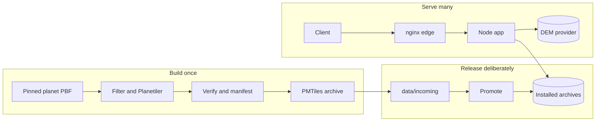

# 1. Philosophy

This is a small tile server, but it is not an accident. Most of its design follows from a handful of
choices: serve an API rather than a product, treat archives as immutable artefacts, pin every input,
separate building from serving, and make operations explicit. Those choices trade convenience for
legibility. They explain why the codebase is small enough to read in an afternoon, and why a failed
deploy is usually obvious.

The principles are not abstract preferences. Each one is visible in the directory layout, the HTTP
contract and the commands. This page explains the reasoning; [2. Architecture](2.architecture.md)
shows the machinery.

## Serve an API, not a product

The server exposes a read-only JSON and tile API. There is no frontend, no account model, no database,
no session store and no write path. That keeps the trust boundary small and the surface auditable.
The public, read-only API is a deliberate stance, not an unfinished feature: authentication and
per-client quotas are deferred until a use case needs them.

The Vite and MapLibre harness under `dev/` is a development tool, not a deployed frontend. It consumes
the same TileJSON and tile endpoints through a proxy, so preview and production exercise the same
contract. The server does not serve the harness, and the harness never gets a private route into the
server.

> [!NOTE]
> The harness can look like a product. It is not. It exists to preview tiles, inspect styling and
> catch integration regressions offline.

Read more: [HTTP contract](2.architecture.md#http-contract), [scope of protection](2.architecture.md#scope-of-protection)
and [3. Dev harness](3.dev-harness.md).

## Archives are immutable; serving is a read path

Each PMTiles source is an archive on local disk. The build ID identifies the archive bytes, not the
recipe, so a versioned tile URL names one fixed set of data. That is why versioned URLs are immutable
and can be cached for a year, while the unversioned route uses a short TTL and points at whatever
`current.pmtiles` contains.

The server opens archives at startup and keeps the file handles. It does not watch the data directory.
Replacing an archive is a deliberate operation: `--install` locally (then a manual restart), or
`promote` and `rollback` on the live server (which restart the service and check readiness). There is
no hidden reload path and no second source of truth about which build is live.

This has a cost: a data change always involves a restart. It also removes a class of race conditions
and makes the served build ID checkable after every change. A missing archive is treated as a normal
degraded state, not a crash: the source reports unavailable, health reports `degraded`, and readiness
fails while other sources continue to serve.

Read more: [Data layout](2.architecture.md#data-layout), [cache policy](2.architecture.md#cache-policy)
and [availability semantics](2.architecture.md#availability-semantics).

## Build once, serve many

The build pipeline is a separate process. The server never invokes it and never reads `dist/`; it only
opens the archives installed under `data/<source>/`. Building is therefore allowed to be slow, heavy
and tool-rich, while serving stays small and dependency-light.

Planet builds need disk and CPU that the tile server should not provide. The remote path creates a
disposable build box, runs the same pipeline there, verifies each archive and transfers only the
resulting pairs into `data/incoming/`. It never promotes. Promotion is a separate, per-source step, so
a multi-source build cannot change the live set by accident.

The pipeline is sequential and repeats the filter and Planetiler build per source. That is slower than
a parallel build, but it is easier to observe, retry and reason about. One shared filter union keeps
the sources consistent; a per-source profile keeps their tiles focused.

Read more: [Build pipeline](2.architecture.md#build-pipeline), [stages](5.pipelines.md#stages) and
[remote builds](5.pipelines.md#remote-builds).

## Pin every input, name every output

A build is only reproducible if its inputs are fixed. The shipped manifest pins the planet snapshot by
URL, date, SHA-256 and MD5, and the Planetiler jar by version, URL and SHA-256. `package.json` requires
Node 24 or newer, and planet builds require the pinned pmtiles CLI. The remote preflight rejects
`planet-latest` and any planet build without a date and at least one checksum.

The output has two identities. The run ID hashes the recipe: source, zooms, pins, profile and filter
hashes, skip flags and tool versions. The build ID hashes the archive bytes. Two builds with the same
bytes share a build ID even when their recipes differ; two builds with different bytes never do. That
distinction is why clients can pin a build ID, while operators can use the run ID to find the work
directory and the recipe that produced it.

The per-source build manifest records what actually happened, not what was intended: the input
provenance, the tool versions, the filter and profile hashes, the verification results and the archive
hash and size. It is the evidence a promotion checks before installing a pair.

Read more: [Toolchain and pins](5.pipelines.md#toolchain-and-pins), [output and build IDs](5.pipelines.md#output-and-build-ids)
and [the pinned snapshot](7.roadmap.md#pinned-snapshot).

## Operations are explicit and reversible

The CLI has one command per job: `build`, `provision`, `deploy`, `status`, `promote` and `rollback`.
Each does one thing and reports what it did. Promotion validates the incoming pair, snapshots the live pair,
installs and rotates it, restarts the service, waits for readiness and checks the advertised build ID.
Rollback installs the previous pair the same way. If a step fails, the previous pair is restored.

Deploy is equally deliberate. It renders the systemd unit and nginx site, validates the site with
`nginx -t`, reloads only on success and restores the previous configuration on failure. It does not
provision the server and does not run from CI. A behavioural change to edge limits is made in code,
deployed and reviewed like any other change; it is not an environment tweak applied by hand.

Edge protection itself is an operations concern. nginx applies per-IP request and connection limits
to tile routes and writes the access log. The Node application stays public and read-only, with no
authentication and no application-level rate limiting. That separation keeps the serving code simple
and puts traffic policy where it can be inspected and reloaded.

The trade-off is manual work. The benefit is an audit trail: every live change has a command, a
validation step and a recovery path. Automation is added when monitoring, backups and rollback have
been exercised, not before.

Read more: [deploy](6.operations.md#deploying-code-and-configuration), [promote and rollback](6.operations.md#promoting-and-rolling-back)
and [edge protection](2.architecture.md#edge-protection).

## Development stays offline and deterministic

The browser-test harness uses a vendored basemap, a committed PMTiles extract and a committed DEM
block. The Playwright test fails on any external request, and the fixture manifest points at absent
PMTiles archives so the test always starts from the same three unavailable sources. Contour generation is
exercised against a local DEM server, not Mapterhorn.

The project keeps runtime dependencies low: `maplibre-contour` for contour generation and `sharp` for
WebP decoding, with the PMTiles reader implemented in the repository. The serving path prefers Node
built-ins and has no web framework. That is a deliberate choice about the size of the dependency
surface, not a rejection of useful tools.

The same manifest schema drives the server, the build and the tests. Development and production differ
in their pins and archives, not in the shape of the configuration. A fixture build exercises the same
stages, the same profiles and the same verification rules as a planet build.

Read more: [offline behaviour](3.dev-harness.md#offline-and-deterministic-behaviour), [the smoke test](3.dev-harness.md#playwright-smoke-test)
and [runtime shape](2.architecture.md#runtime-shape).

## The codebase follows the shape

The directory layout mirrors the lifecycles rather than the other way round:

| Path                            | Responsibility                                                                                  |
| ------------------------------- | ----------------------------------------------------------------------------------------------- |
| `src/server.mjs`, `src/app.mjs` | Process entry, HTTP routing and response handling.                                              |
| `src/sources/`, `src/lib/`      | PMTiles and contour adapters, the PMTiles reader, DEM decoding, configuration and HTTP helpers. |
| `bin/ogis.mjs`, `src/build/`    | The CLI and the build, verification, manifest and remote-build modules.                         |
| `src/deploy/`, `src/provision/` | Deploy, status, promote, rollback, nginx rendering and cloud-init provisioning.                 |
| `build/profiles/`               | The Planetiler profiles for POIs, routes and paths.                                             |
| `config/layers.json`            | The runtime manifest and the build pins.                                                        |
| `dev/`                          | The offline Vite and MapLibre harness.                                                          |
| `test/`                         | Unit, integration, build and browser tests, plus the committed fixtures.                        |
| `docs/`, `TODOS.md`             | The numbered documentation path and the deferred-work backlog.                                  |

## Three lifecycles

The system has three lifecycles, and most confusion disappears once you know which one you are in.

- **Build** turns a pinned input into a verified archive with a build manifest. It happens on a build
  box or a workstation, never in the serving process.
- **Release** moves a verified pair into `data/incoming/`, then promotes it, restarts the service and
  confirms the build ID. Deploy is the parallel code path for the server itself.
- **Serve** is the request path: nginx, then Node, then a local archive or the DEM provider. It never
  writes an archive and never changes which build is live.

## How to read this documentation

The numbered pages follow the same path as the system:

| Pages | What they cover                                                        |
| ----- | ---------------------------------------------------------------------- |
| 0–1   | The vocabulary and the design choices behind it.                       |
| 2–4   | The runtime: serving core, development harness and contour generation. |
| 5–7   | Delivery and operation: build, deploy and phase status.                |

Read 0–2 in order if you are new, then jump to the page for the part you are changing. Each page ends
with previous/next navigation, and the [documentation index](README.md) is the hub. The authoritative
detailed backlog is [TODOS](../TODOS.md).

**Previous:** [0. Terminology](0.terminology.md) · **Next:** [2. Architecture](2.architecture.md) · [Documentation index](README.md)
