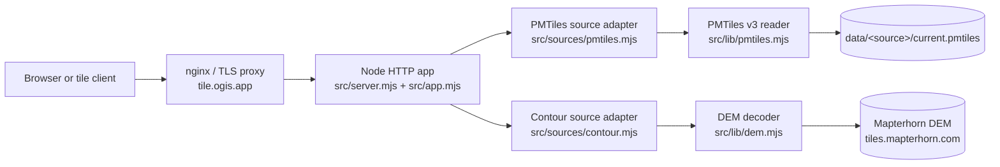

# 2. Architecture — the serving core

The serving core is the part of the system that answers HTTP requests. It validates a runtime
manifest, opens PMTiles v3 archives from local disk, generates contour tiles from a remote elevation
model, and returns TileJSON and Mapbox Vector Tiles. There is no framework, database, object store
or production frontend.

This page moves from process startup through the runtime manifest, the two source adapters, the
PMTiles reader and the HTTP contract, then ends with the deployment shape and the limits it imposes. After it you should be able to predict the status code, headers and cache policy
for any route, and explain why replacing an archive needs a restart.

The rest of the system sits around that core. The development harness (Phase 2) runs under `dev/`
and consumes the same endpoints through Vite's proxy; contours (Phase 3) are implemented in the
serving core; the build pipeline (Phase 4) is a separate command that produces the archives.

The service is live at <https://tile.ogis.app> on a Hetzner CX23, deployed with the Phase 5
operational tooling and serving the Phase 6 planet archives. Phase 7 is in progress: the per-IP edge-protection slice is
deployed and the remaining hardening items are tracked in [7. Roadmap](7.roadmap.md). Day-to-day
operation is in [6. Operations](6.operations.md).

| Concern                                           | Location                                                         |
| ------------------------------------------------- | ---------------------------------------------------------------- |
| Process entry, configuration loading and shutdown | [`src/server.mjs`](../src/server.mjs)                            |
| HTTP application and route handling               | [`src/app.mjs`](../src/app.mjs)                                  |
| Manifest validation                               | [`src/lib/config.mjs`](../src/lib/config.mjs)                    |
| Response helpers and CORS                         | [`src/lib/http.mjs`](../src/lib/http.mjs)                        |
| PMTiles v3 reader                                 | [`src/lib/pmtiles.mjs`](../src/lib/pmtiles.mjs)                  |
| PMTiles source adapter                            | [`src/sources/pmtiles.mjs`](../src/sources/pmtiles.mjs)          |
| Contour source adapter                            | [`src/sources/contour.mjs`](../src/sources/contour.mjs)          |
| DEM fetch and WebP decoding                       | [`src/lib/dem.mjs`](../src/lib/dem.mjs)                          |
| Build command, stages and manifests               | [`bin/ogis.mjs`](../bin/ogis.mjs), [`src/build/`](../src/build/) |
| Remote build orchestration                        | [`src/build/remote.mjs`](../src/build/remote.mjs)                |
| Build profiles                                    | [`build/profiles/`](../build/profiles/)                          |
| Provisioning and cloud-init                       | [`src/provision/`](../src/provision/)                            |
| Deploy, status, promote and rollback              | [`src/deploy/`](../src/deploy/)                                  |
| Runtime manifest                                  | [`config/layers.json`](../config/layers.json)                    |
| Unit, integration and Playwright tests            | [`test/`](../test/)                                              |

## Runtime shape

The project is Node.js 24, ESM and plain JavaScript. [`package.json`](../package.json) declares `"type": "module"`, requires Node `>=24`, and has two runtime dependencies: `maplibre-contour` (pinned at `0.1.1`) for contour generation and `sharp` for WebP decoding. Vitest, Prettier, the reference PMTiles package, the vector-tile decoder, Vite, MapLibre and Playwright are development dependencies. There is no web framework.

`src/server.mjs` is the executable entry point:

1. It derives the repository root from `import.meta.url` and selects the default manifest at `config/layers.json`.
2. `CONFIG_PATH`, when set, is resolved with `path.resolve()` against the process working directory. The default manifest path is absolute.
3. `loadConfig(configPath, { repoRoot })` reads and validates the manifest.
4. `PUBLIC_BASE_URL` overrides the manifest base URL at startup; `HOST` and `PORT` override the manifest bind address when the server starts. `PORT` is re-checked as an integer from 1 to 65535.
5. `createApp(config)` builds the source adapters and the HTTP server. PMTiles adapters open their archives; contour adapters require no archive and perform no network request at startup. A source-construction failure closes any sources that were already opened, and the process exits with status 1.
6. The server listens on the configured host and port and logs the listening URL.

`npm start` runs `node --env-file-if-exists=.env src/server.mjs`, so a local `.env` is loaded when present. Running `node src/server.mjs` directly does not load `.env`.

`createApp()` returns `{ server, sources, close }`. The server is `node:http` — HTTP/1.1, no middleware chain. Route handling lives in `src/app.mjs` as an async request handler. Unhandled handler rejections become a JSON `500 internal_error`; if headers have already been sent, the connection is destroyed.

Shutdown is explicit and idempotent. `SIGINT` and `SIGTERM` call `app.close()`, which:

- stops accepting new connections;
- closes idle connections;
- waits up to five seconds for in-flight requests;
- closes remaining connections after the grace period;
- closes the open PMTiles readers and clears the contour source's in-memory caches.

A failed listen (for example, a port already in use) closes the app and exits with status 1. Configuration and startup errors are printed as a single line, without a stack trace.



## Manifest

[`config/layers.json`](../config/layers.json) is the single source of truth for the server and every source. The runtime manifest is JSON, versioned and validated before any archive is opened. Unknown keys are rejected at every level, including inside attribution entries.

The excerpt below is abridged: it shows one `pmtiles` source and one `contour` source and omits optional server fields. The shipped manifest defines `pois`, `routes` and `paths` as PMTiles sources and `contours` as a contour source.

```json
{
  "version": 1,
  "server": { "host": "127.0.0.1", "port": 11010 },
  "sources": {
    "pois": {
      "kind": "pmtiles",
      "title": "Outdoor POIs",
      "description": "Huts, shelters, viewpoints and other outdoor points of interest.",
      "attribution": [
        { "title": "OpenStreetMap", "href": "https://www.openstreetmap.org/copyright" }
      ],
      "archiveDir": "data/pois",
      "minzoom": 12,
      "maxzoom": 16
    },
    "contours": {
      "kind": "contour",
      "title": "Terrain contours",
      "description": "Contour lines generated on demand from a worldwide elevation model.",
      "attribution": [{ "title": "Mapterhorn", "href": "https://mapterhorn.com/attribution" }],
      "minzoom": 1,
      "maxzoom": 15,
      "demUrl": "https://tiles.mapterhorn.com/{z}/{x}/{y}.webp",
      "encoding": "terrarium",
      "demMaxzoom": 12,
      "thresholds": { "8": [150, 750], "12": [20, 100] }
    }
  }
}
```

### Server fields

| Field           | Requirement                                                                                                                                   |
| --------------- | --------------------------------------------------------------------------------------------------------------------------------------------- |
| `host`          | Required non-empty string. The shipped manifest uses `127.0.0.1`.                                                                             |
| `port`          | Required integer from 1 to 65535. The shipped manifest uses `11010`.                                                                          |
| `publicBaseUrl` | Optional absolute `http` or `https` URL, or `null`. It must not include a query string or fragment. Trailing slashes on the path are removed. |
| `trustProxy`    | Optional boolean, default `false`. When `true`, forwarded headers may affect TileJSON URLs.                                                   |

`publicBaseUrl` is normalised to `origin + pathname`; a value such as `https://tiles.example/base/` becomes `https://tiles.example/base`.

### Source fields

All sources share these fields:

| Field         | Requirement                                                                                                                                                    |
| ------------- | -------------------------------------------------------------------------------------------------------------------------------------------------------------- |
| `kind`        | Required. `pmtiles` or `contour`; other kinds are rejected.                                                                                                    |
| `title`       | Required non-empty string. Used as the TileJSON name and catalogue title.                                                                                      |
| `description` | Required non-empty string.                                                                                                                                     |
| `attribution` | Required array of `{ title, href }` objects. Both fields are required and non-empty. `href` must be an absolute `http` or `https` URL. The array may be empty. |
| `minzoom`     | Required integer. PMTiles sources accept 0 to 26; contour sources accept 1 to 15.                                                                              |
| `maxzoom`     | Required integer. PMTiles sources accept 0 to 26; contour sources accept 1 to 15. It must be greater than or equal to `minzoom`.                               |

A `pmtiles` source adds these fields:

| Field        | Requirement                                                                                                                      |
| ------------ | -------------------------------------------------------------------------------------------------------------------------------- |
| `archiveDir` | Required non-empty string. A relative path is confined to the repository root; an absolute path is trusted.                      |
| `build`      | Optional build configuration. Validated by `bin/ogis.mjs build`, ignored by the serving core. See [Build fields](#build-fields). |

A `contour` source adds the fields in [Contour fields](#contour-fields) and rejects `archiveDir` and
`build`.

Source names must match `^[a-z][a-z0-9-]*$`. The `sources` object must be non-empty.

### Contour fields

| Field          | Requirement and default                                                                                                                                     |
| -------------- | ----------------------------------------------------------------------------------------------------------------------------------------------------------- |
| `demUrl`       | Required absolute `http` or `https` URL containing `{z}`, `{x}` and `{y}`.                                                                                  |
| `encoding`     | Required; `terrarium` or `mapbox`.                                                                                                                          |
| `demMaxzoom`   | Optional integer from 0 to 17, default `12`. It must not exceed the source `maxzoom`.                                                                       |
| `demTileSize`  | Optional integer from 256 to 2048, default `512`.                                                                                                           |
| `cacheSize`    | Optional integer from 1 to 1000, default `100`. Maximum entries in each in-memory DEM cache.                                                                |
| `timeoutMs`    | Optional integer from 1000 to 60000, default `10000`. Per-DEM-tile request timeout.                                                                         |
| `buffer`       | Optional integer from 0 to 64, default `1`. Contour tile buffer.                                                                                            |
| `extent`       | Optional integer from 256 to 8192, default `4096`. MVT extent.                                                                                              |
| `contourLayer` | Optional non-empty string, default `contours`. MVT layer name.                                                                                              |
| `elevationKey` | Optional non-empty string, default `ele`. Elevation property in metres.                                                                                     |
| `levelKey`     | Optional non-empty string, default `level`. 0 for a minor contour, 1 for a major contour.                                                                   |
| `cacheMaxAge`  | Optional integer from 60 to 86400, default `86400`. Used in `Cache-Control` for unversioned contour tiles.                                                  |
| `thresholds`   | Required object with at least one entry. Keys are canonical decimal zooms from 0 to 26; values are `[minor, major]` positive integers with `minor < major`. |

The shipped contour configuration and threshold table are documented in [4. Contours](4.contours.md#configuration).

### Build fields

The runtime manifest also carries the build pipeline's configuration. The top-level `build` object
accepts `planet` (`date`, `url`, `sha256`, `md5`), `tools` (`planetiler`, `pmtiles`) and `outputDir`.
A `pmtiles` source's `build` object accepts `profile`, `profileKind`, `profileFile`, `heap`,
`heapPlanet`, `minzoom`, `maxzoom`, `expressions`, `sampleTiles`, `sizeFloor` and `verification`.

`build.planet` may pin SHA-256, MD5 or both. A planet build requires at least one checksum; SHA-256 is
preferred, both are verified when present, and MD5 must be exactly 32 lowercase hexadecimal
characters. The shipped manifest pins the 2026-10-26 snapshot URL and date with both digests. Use a
dated snapshot URL rather than `planet-latest`; the remote preflight rejects `planet-latest`.

The serving core only checks that the top-level and source-level `build` keys are allowed; it ignores
their contents. `bin/ogis.mjs build` validates them strictly before doing any work, requires at least
one source with a build profile, and rejects a build block on a contour source. Full rules, defaults
and profile behaviour are in [5. Build pipelines](5.pipelines.md).

### Validation rules

- The top level accepts only `version`, `server`, `sources` and `build`; `server` accepts only `host`, `port`, `publicBaseUrl` and `trustProxy`. A PMTiles source accepts only the common source fields plus `archiveDir` and `build`; a contour source accepts only the common source fields plus the contour fields above. Mixing kinds is rejected.
- `version` must be exactly `1`.
- Every required field must be present. `host`, `port`, source names, attribution URLs, zoom ranges and the contour fields are checked as described above.
- A contour `demUrl` must be absolute, use `http` or `https`, and contain all three placeholders. `thresholds` keys must be canonical decimal zooms and each interval must be a `[minor, major]` pair of positive integers with `minor < major`.
- A relative `archiveDir` is rejected if any path segment is `..`, and the resolved path must remain inside the repository root. Backslashes are treated as path separators for this check.
- An absolute `archiveDir` is normalised and trusted, including when it points outside the repository. This is deliberate for deployment layouts where archives live on a mounted disk.
- Path confinement is lexical. Symlinks inside the repository are not resolved during validation.

`repoRoot` semantics are important when `CONFIG_PATH` is used. `src/server.mjs` always computes the repository root from its own module URL and passes it to `loadConfig()`. A relative `archiveDir` is therefore resolved against the repository root, **not** against the directory containing the custom manifest. A manifest at `/etc/ogis/layers.json` with `"archiveDir": "data/pois"` still resolves to `<repository>/data/pois`. `CONFIG_PATH` itself is resolved against the current working directory.

After validation, `HOST` and `PORT` override `server.host` and `server.port`, and `PUBLIC_BASE_URL` overrides `server.publicBaseUrl` under the same rules. `CONFIG_PATH` is different: it selects the manifest before validation, so it changes which file is read rather than a value inside it.

## Data layout

PMTiles archives live on local disk, are not committed, and are ignored by git through the repository-wide `data/` rule. Each PMTiles source owns a directory. A fresh checkout has no archives, so every configured PMTiles source starts unavailable. Contour sources have no archive directory and no `data/` entry; they are available as soon as they are constructed.

The tree shows the full layout for a PMTiles source, including optional sidecars and the rollback archive; only `current.pmtiles` is required for a source to become available.

```text
data/pois/
├── current.pmtiles
├── current.json
├── previous.pmtiles
└── previous.json
```

- `current.pmtiles` is the archive served by unversioned tile URLs and by versioned URLs whose build ID matches the current sidecar. It is the only file required for the source to become available.
- `previous.pmtiles` is the optional rollback archive. It is served only through a versioned URL whose build ID matches the previous sidecar.
- `current.json` and `previous.json` are optional sidecars. The build pipeline writes full build manifests there; the serving core reads only `buildId`. A missing, unreadable or invalid sidecar falls back to the role name, `current` or `previous`.
- The serving core accepts any build ID matching `[a-zA-Z0-9._-]+`. The build pipeline emits content-addressed IDs: `fixture-<12 hex>` for fixture builds and `<YYYYMMDD>-<12 hex>` for planet builds. Build IDs should be distinct; if current and previous share an ID, current wins.

The PMTiles adapter opens both archives at startup and keeps the file handles. Consequences:

- A missing current archive does not stop the process. The source reports `available: false` and `buildId: null`; health becomes `degraded`; readiness returns 503; TileJSON and tile requests for the source return 503.
- A missing previous archive only removes the rollback URL; it does not degrade the source.
- A current archive that is unreadable, corrupt or not MVT is treated as unavailable. The process continues.
- A source is also unavailable when the configured zoom range does not intersect the archive header's zoom range.
- Archives are not watched. Replacing `current.pmtiles` under a running process is not detected; promotion and rollback require a restart.

The build pipeline's `--install` performs the swap: it replaces `current.pmtiles` and `current.json`,
rotates a valid current pair to `previous`, and restores the old files if any step fails. The serving
core still provides no file watcher or reload signal, so a restart is required after installing.

## Build pipeline

The build pipeline is a separate command, not part of the server process. It reads the same runtime
manifest, builds every selected `pmtiles` source that declares a `build` block, and writes
`<outputDir>/<buildId>/<source>/current.pmtiles` plus `build.json` (the default output directory is
`dist`). `--install` copies the archive and its build manifest into the source's `archiveDir`,
normally `data/<source>/`, writing the installed manifest as `current.json`. The serving core never
invokes the builder and does not read `dist/`.

Source kinds are strict: only `pmtiles` sources can declare a build, and contour sources reject the `build` key. The shipped profiles are POIs (YAML), routes (Java) and paths (Java); contours have no archive build.

Build IDs identify archive bytes: `fixture-<12 hex>` or `<YYYYMMDD>-<12 hex>`. The separate run ID identifies the recipe and names the temporary work and staging directories. Versioned tile URLs use the build ID, which is why installing a different archive changes every versioned URL and leaves old URLs tied to `previous` until it is rotated out. The per-source build manifest records the provenance, tool versions, profile and filter hashes, verification results and archive hash; the server reads only `buildId` from the installed sidecar. Full stage-by-stage behaviour, profiles, verification rules and flags are in [5. Build pipelines](5.pipelines.md).

### Remote build boxes

`ogis build --remote` moves the build to a disposable Hetzner Cloud server. It creates a labelled box, syncs the repository, runs the same pipeline there and transfers each archive pair into the tile server's `data/incoming/` directory. It never promotes. A successful build destroys the box unless kept; `--dry-run` makes no cloud calls and `--yes` is required to create the billable box.

For a planet build, the preflight requires a date, a URL and at least one valid checksum, and rejects `planet-latest`; the resolved pins are forwarded to the box. The deployment topology and promote hand-off are in [Deployment (Phase 5)](#deployment-phase-5); the full lifecycle is in [5. Build pipelines](5.pipelines.md#remote-builds) and the operator runbook in [6. Operations](6.operations.md#remote-builds).

## Deployment (Phase 5)

Phase 5 is implemented and live, and the Phase 6 planet archives are deployed. The tile server is a
Hetzner CX23 in `nbg1` running Ubuntu 26.04.
The application is deployed under `/opt/ogis-tiles` and runs as `ogis-tiles.service` under the
`deploy` user, bound to loopback only. nginx terminates TLS on 80 and 443, redirects HTTP to HTTPS
and proxies to `127.0.0.1:11010`; certbot issues and renews the certificate. Data lives under
`/opt/ogis-tiles/data`, with `incoming/` for archive pairs awaiting promotion.

### Provisioning

`ogis provision` rebuilds an existing Hetzner Cloud server from rendered cloud-init. It does not buy
the server or create DNS records: the server, DNS A record and `.env` values are prerequisites. The
command defaults to a dry run; `--yes` performs the rebuild, and a real rebuild snapshots the server
first unless `--no-snapshot` is used. It verifies the target's type, location and x86 architecture,
rebuilds with Ubuntu 26.04, waits for SSH and cloud-init, checks the reported OS and enables
fail2ban. A rebuild replaces the operating system and local data; the snapshot is the recovery path.

Cloud-init creates the `deploy` and `build` users, installs a pinned Node.js, nginx, certbot, ufw and
rsync, writes the initial systemd unit and HTTP-only nginx site, creates the data and incoming
directories, and installs the two SSH keys. Provisioning installs and enables fail2ban after
cloud-init has finished. The deploy key is a normal sudo-capable login.
The build key is restricted to a forced `rrsync -wo /opt/ogis-tiles/data/incoming` command with
`restrict`. Cloud-init installs but does not start the tile service; run `ogis deploy` afterwards to
install TLS, the cache configuration and the running service.

### Deploy topology

`ogis deploy` syncs the server code (`src/`, `bin/`, `config/` and the package files; `data/`,
`.env*` files at any depth, tests, docs and development files are excluded), installs production
dependencies with `npm ci --omit=dev`, renders the systemd unit and nginx site, restarts the service
and reloads nginx. It issues or reuses the TLS certificate, creates the nginx cache directories and
installs the certbot renewal hook. The unit sets `HOST=127.0.0.1`; when the runtime manifest does not set
`publicBaseUrl`, it also sets `PUBLIC_BASE_URL` to the public origin (`https` when TLS is active), so
TileJSON URLs do not depend on forwarded headers.

nginx caches source responses under `/var/cache/nginx/<source>`. The shipped manifest uses a 20 GB
cache budget: 2 GB is reserved for contours and the remainder is split evenly across the PMTiles
sources. PMTiles TileJSON and tiles are cached for an hour; contour responses are cached for a day
with a cache lock to collapse concurrent generation. Health, readiness, catalogue and index
responses bypass the cache. Cache directories are created by deploy and are not part of the
repository.

Promotion and rollback run on the server through `ogis promote --source=<name>` and
`ogis rollback --source=<name>`. A promotion validates the incoming archive and its content-addressed
manifest, snapshots the live pair, installs it with the same rotation used by `--install`, restarts
the service, waits for readiness and verifies the advertised build ID. A rollback installs the
previous pair the same way. A failure restores the snapshot and restarts; an incoming pair is
consumed only after success. The readiness wait is necessary because `systemctl restart` returns
before Node is listening; the exact retry windows are in
[Service restart and readiness](6.operations.md#service-restart-and-readiness).

### Edge protection

The edge-protection configuration is deployed: nginx applies per-IP controls to the live site. The
controls are independent of the Node application, which still has no authentication,
application-level rate limiting or per-client quotas. The limits key on `$binary_remote_addr`.

| Route group                                | Rate      | Burst | Connections per IP | `proxy_read_timeout` |
| ------------------------------------------ | --------- | ----- | ------------------ | -------------------- |
| PMTiles tiles `/<source>/`                 | `100 r/s` | `200` | `40`               | `30s`                |
| Contour tiles `/contours/`                 | `10 r/s`  | `40`  | `8`                | `75s`                |
| `/health`, `/ready`                        | unmetered | —     | —                  | `10s`                |
| `/sources`, `/` and every `/<source>.json` | unmetered | —     | —                  | `60s`                |

Requests over the request rate or connection limit are rejected by nginx with `429` and
`Retry-After: 1`; `limit_req` and `limit_conn` log rejections at warn level. This is an edge
rejection and is distinct from the application's `503 source_unavailable`, `503 upstream_unavailable`
and not-ready responses, which originate in Node and describe local source state. `Retry-After` is
mapped from the response status, so it appears only on the edge `429`.

All proxied locations share `proxy_connect_timeout 5s` and `proxy_send_timeout 30s`. The server block
adds `client_max_body_size 64k`, `client_header_timeout 10s`, `client_body_timeout 10s`,
`send_timeout 30s` and `keepalive_timeout 30s`.

The per-host access log is `/var/log/nginx/<host>.access.log` and uses the `ogis` format. Each line
records the request, `$status`, `rt=$request_time`, `urt=$upstream_response_time` and
`cache=$upstream_cache_status`. Responses still carry `X-Cache-Status`.

The values live in the exported `EDGE_LIMITS` constants in
[`src/deploy/render.mjs`](../src/deploy/render.mjs). They are deliberate code values, not environment
variables; changing them requires a code change and `ogis deploy`. The provisioning bootstrap in
[`src/provision/cloud-init.mjs`](../src/provision/cloud-init.mjs) installs an HTTP-only nginx site
with the same global body limit and timeouts, but without per-route rate limits or the custom `ogis`
log format. The first `ogis deploy` installs TLS, the per-route controls and the access log, so a
freshly provisioned box is never throttled before the application is deployed.

Deploy renders the site, runs `nginx -t` and reloads only when validation passes. If validation or a
later install step fails, deploy restores the previous site configuration. Behavioural rollback is
revert-and-redeploy: revert the change in the checkout and run `ogis deploy` again.

> [!WARNING]
> If a CDN or reverse proxy is placed in front of nginx, add trusted real-IP handling first, for
> example `real_ip_header` and `set_real_ip_from`. Without it nginx sees the proxy address and every
> client shares one limit bucket.

### Remote build box

`ogis build --remote` creates a labelled, disposable Hetzner Cloud server, syncs the repository,
runs the build pipeline there, and transfers each source's pair into `data/incoming/<source>/` with
the restricted build key. The default `cpx62` in `nbg1` provides the disk for a filtered planet
build; the tile server remains a CX23 and is upgraded to CX33 manually when its data filesystem
fills. The box is destroyed after a successful transfer unless kept; `--no-transfer` keeps it
because the output would otherwise be destroyed. Failures before the build destroy the box; failures
during or after the build keep it for inspection. Cleanup by name only deletes servers labelled
exactly `managed-by=ogis-tiles` and `role=build-box`.

The transfer is staged through `incoming/`, not the live directories, so a build cannot change
served data. The build key is write-only inside the incoming root; `TILE_DATA_DIR` and
`TILE_INCOMING_DIR` must match the provisioned paths. The preflight supports rsync 3.2.3 or newer
with `--mkpath` and macOS openrsync with `--no-dirs`; the final transfer uses `--no-group` so the
destination's setgid `ogis` group survives. Details:
[5. Build pipelines](5.pipelines.md#remote-builds) and
[6. Operations](6.operations.md#remote-builds).

## Contour source

[`src/sources/contour.mjs`](../src/sources/contour.mjs) generates contour tiles instead of reading them from disk. It wraps `maplibre-contour`'s `LocalDemManager` and supplies a Node WebP decoder from [`src/lib/dem.mjs`](../src/lib/dem.mjs). The full behaviour, configuration and threshold table are in [4. Contours](4.contours.md).

For a request at `z/x/y`, the source returns an empty tile when `z` is outside 1–15, selects the highest configured threshold at or below `z`, and asks the manager for a contour tile. The manager fetches the 3×3 DEM neighbourhood at `min(z, demMaxzoom)`; each DEM tile is requested with `Accept: image/webp`, a per-request timeout and a 5 MiB body cap, decoded with `sharp`, and converted to elevations. The source encodes the isolines as an MVT in `contourLayer` with `elevationKey` and `levelKey` properties, gzips it and returns it to the HTTP layer.

The 3×3 neighbourhood is required for line continuity. If any neighbour is missing — the provider returns `204`, `404` or `410` — the whole contour tile is empty; the server never fills missing elevation with 0 m. A missing neighbour is therefore indistinguishable from a genuinely empty tile and returns `204`. Upstream rate limits, server errors and timeouts become `503 upstream_unavailable` with `Retry-After`; decode failures become `500 internal_error`; a versioned contour URL is `404`. The full mapping is in [4. Contours](4.contours.md#failure-semantics).

The contour source has a configuration-derived build ID rather than an archive build ID. It is the first twelve hexadecimal characters of a SHA-256 hash over the generation options (`demUrl`, `encoding`, `demMaxzoom`, `demTileSize`, `thresholds`, `buffer`, `extent`, `contourLayer`, `elevationKey`, `levelKey`, `minzoom`, `maxzoom`). `cacheSize`, `timeoutMs` and `cacheMaxAge` are excluded because they do not affect tile content.

`LocalDemManager` keeps three bounded in-memory caches — raw DEM tiles, parsed DEM tiles and generated contour tiles — each holding up to `cacheSize` entries. The cache is per process and cleared on `close()`; there is no persistent cache and no shared cache. Construction does not contact the DEM provider, so `/health` and `/ready` reflect local serving capability, not Mapterhorn's current state. An upstream outage produces `503` on individual contour tile requests but leaves health and readiness unchanged.

The development harness uses the same source with `demUrl` pointed at Vite's `/dem` fixture, so the browser smoke test exercises real contour generation without external requests; see [3. Dev harness](3.dev-harness.md#contour-fixture).

## PMTiles reader

[`src/lib/pmtiles.mjs`](../src/lib/pmtiles.mjs) implements the subset of the PMTiles v3 specification needed to serve vector tiles. It is deliberately independent of the reference `pmtiles` package; the tests compare both implementations.

### Header

`open()` stats the file and reads the fixed 127-byte header. The reader checks:

- the `PMTiles` magic string;
- spec version `3`;
- little-endian section offsets and lengths, converted from 64-bit values only when they fit in `Number.MAX_SAFE_INTEGER`;
- internal compression and tile compression are each either `1` (none) or `2` (gzip);
- root directory, metadata, leaf directory and tile-data sections fit inside the file and do not overlap the header (zero-length sections are allowed);
- each section respects its size cap.

The header supplies the zoom range, tile type, compression modes and geographic bounds. `tileType` is parsed but not enforced by the reader; the source adapter requires type `1` (MVT). `clustered` is parsed but unused.

The root directory is read and decoded during `open()`. Leaf directories are read lazily.

### Directories and tile IDs

Directories use the PMTiles varint layout: entry count, delta-encoded tile IDs, run lengths, lengths, then offsets. An offset of `0` means "immediately after the previous entry"; any other value stores `offset + 1`. Directory entries either describe a run of tile contents (`runLength > 0`) or point to a leaf directory (`runLength === 0`).

Tile coordinates are converted to a Hilbert tile ID with the standard PMTiles ordering, offset by `(4^z - 1) / 3`. Lookups binary-search the directory for the greatest tile ID less than or equal to the requested ID, then check the run length. A missing candidate, a zero-length entry or an ID outside the run returns `null`. The reader follows leaf directories up to 16 levels.

The implementation is checked against the reference package exhaustively at low zooms and at sampled high zooms, including the corners of zoom 26.

### Tiles and compression

`getTile(z, x, y)` returns `null` when the zoom is outside the archive header's range, when no directory entry matches, or when the entry has no content. Otherwise it reads the tile's stored bytes and returns:

```js
{ data: Buffer, compression: 'gzip' | 'none' }
```

The bytes are returned exactly as stored. The reader does not decode MVT, recompress tiles or inspect the vector-tile payload. The source adapter is what rejects non-MVT archives.

Internal compression (directories and metadata) and tile compression are limited to gzip and identity. Brotli and zstd archives are rejected at open time. Gzip decompression uses Node's `gunzipSync()` with an output limit, so a malicious archive cannot expand without bound.

### Metadata and bounds

Metadata is read through the internal compression path, decoded as UTF-8 and parsed as JSON. A JSON object is returned as-is; valid non-object JSON (for example `null`) becomes `{}`; malformed JSON throws. The source adapter catches metadata errors and falls back to `{}`, so a bad metadata block does not make an otherwise readable archive unavailable. `vector_layers` is copied into TileJSON only when the metadata value is an array.

Bounds come from the header's `minLon`, `minLat`, `maxLon` and `maxLat` fields, converted from fixed-point integers to degrees. They are emitted as TileJSON `bounds` in `[west, south, east, north]` order.

### Limits

| Limit                           | Value      |
| ------------------------------- | ---------- |
| Header size                     | 127 bytes  |
| Root or leaf directory size     | 64 MiB     |
| Directory entries               | 10,000,000 |
| Directory nesting               | 16 levels  |
| Metadata section                | 16 MiB     |
| Stored tile                     | 32 MiB     |
| Identity decompression per tile | 64 MiB     |

Offsets and lengths must be safe integers. Section reads are bounds-checked against the real file size before allocation, so a forged header cannot request an enormous buffer.

### Concurrency and lifecycle

`open()` is safe to call concurrently. The first caller starts one open operation; every concurrent caller receives the same promise and the same header. `close()` waits for an in-flight open, clears the header, root directory, metadata cache and leaf-directory cache, and closes the file handle. A reader can be reopened after closing.

Leaf directories are cached by `offset:length`. The cache defaults to 64 directories and evicts the least recently used entry when it grows beyond that size.

### Error handling

Open-time failures are explicit: a missing file, bad magic, unsupported version, unsupported compression, a truncated or oversized section, or a corrupt root directory all reject `open()` with a descriptive error. The source adapter catches those errors and marks the source unavailable; it does not crash the process.

Read-time failures — a corrupt leaf directory, an out-of-range tile entry or an oversized tile — throw from `getTile()`. The HTTP layer catches them and returns a generic `500 internal_error`, with no stack trace or filesystem detail in the response.

### Why stored bytes are served as-is

When an archive stores tiles with gzip compression, the bytes are already compressed. Recompressing on every request would spend CPU for no size benefit and would change the payload from the bytes the archive author produced. The PMTiles path therefore:

- returns the stored gzip bytes directly when the client accepts gzip, with `Content-Encoding: gzip` and `Vary: Accept-Encoding`;
- decompresses once, with a size limit, when the client does not accept gzip;
- never compresses an identity-stored tile;
- never compresses twice.

The `ETag` includes the selected encoding, so a gzip representation and an identity representation of the same tile are distinct cache entries.

## HTTP contract

The server exposes a read-only JSON API and tile endpoints. All routes are handled directly in [`src/app.mjs`](../src/app.mjs); there is no static-file handler.

| Method        | Path                                  | Success        | Notes                                                                                                                                                    |
| ------------- | ------------------------------------- | -------------- | -------------------------------------------------------------------------------------------------------------------------------------------------------- |
| `GET`, `HEAD` | `/`                                   | `200`          | Service index: service name, version and endpoint links.                                                                                                 |
| `GET`, `HEAD` | `/health`                             | `200`          | Always `200`; `status` is `ok` or `degraded`, with per-source availability and build IDs.                                                                |
| `GET`, `HEAD` | `/ready`                              | `200`          | `{ "status": "ready" }`; returns `503` with the unavailable local source names.                                                                          |
| `GET`, `HEAD` | `/sources`                            | `200`          | Catalogue of every source, including unavailable ones.                                                                                                   |
| `GET`, `HEAD` | `/<source>.json`                      | `200`          | TileJSON 3.0.0 for an available source; `503` when unavailable.                                                                                          |
| `GET`, `HEAD` | `/<source>/{z}/{x}/{y}.pbf`           | `200` or `204` | Unversioned tile for any source. `204` when a PMTiles source has no tile, a request is outside a contour zoom range, or contour DEM coverage is missing. |
| `GET`, `HEAD` | `/<source>/<buildId>/{z}/{x}/{y}.pbf` | `200` or `204` | Versioned PMTiles tile only. Contour paths return `404`; unknown build IDs return `404`.                                                                 |
| `OPTIONS`     | Any known route                       | `204`          | CORS preflight with `Allow` and `Access-Control-Allow-Methods`.                                                                                          |

`/contours/{z}/{x}/{y}.pbf` is the only contour tile route; there is no versioned contour URL. The service index exposes the versioned pattern as `versionedPmtilesTiles`.

### Status codes

| Code  | Meaning                                                                                                                      |
| ----- | ---------------------------------------------------------------------------------------------------------------------------- |
| `200` | Successful JSON or tile response.                                                                                            |
| `204` | Empty tile (no archive tile, outside a contour zoom range, or missing DEM coverage), or a successful `OPTIONS` preflight.    |
| `304` | `If-None-Match` matched the representation's `ETag`.                                                                         |
| `400` | Invalid tile coordinates, invalid build ID, or a query string on a tile path.                                                |
| `404` | Unknown route, source or build ID, or a versioned contour tile URL.                                                          |
| `405` | Known route with a method other than `GET`, `HEAD` or `OPTIONS`.                                                             |
| `429` | The per-IP nginx edge limit for a tile route was exceeded; carries `Retry-After: 1`.                                         |
| `503` | The source is unavailable (missing, corrupt or non-MVT archive, an empty zoom intersection, or an unavailable DEM upstream). |
| `500` | Unexpected internal or archive-read failure, or a contour decode failure.                                                    |

`/health` remains `200` when degraded; monitoring should inspect the body or use `/ready`. `/ready` is the endpoint that fails with `503`.

`429` is generated by nginx before the request reaches Node, so its body is not one of the JSON error
objects below. The application never emits `429`. `/health`, `/ready`, `/sources`, `/` and every
`/<source>.json` route are unmetered at the edge.

Error bodies are JSON objects with an `error` string:

- `not_found`
- `method_not_allowed`
- `invalid_build_id`
- `invalid_tile_coordinates`
- `query_string_not_allowed`
- `source_unavailable`
- `upstream_unavailable`
- `internal_error`

`upstream_unavailable` is specific to contour generation: the DEM provider returned a rate limit, a server error or an unusable status, or the request timed out. It always carries a `Retry-After` header.

Tile coordinate validation is strict: `z` must be an integer from 0 to 26, and `x` and `y` must be integers with `0 <= x,y < 2^z`. Only decimal digits are accepted, so signs, fractions and exponents are rejected. A query string on a tile path returns `400`; query strings on JSON routes are ignored.

### Methods, HEAD and CORS

Route resolution happens before method handling. An unknown path returns `404` even for `OPTIONS` or `POST`; a known path with an unsupported method returns `405` with `Allow: GET, HEAD, OPTIONS`.

`HEAD` uses the same status and headers as `GET`, including `Content-Length`, but sends no body. `OPTIONS` on a known route returns `204` with:

- `Allow: GET, HEAD, OPTIONS`
- `Access-Control-Allow-Methods: GET, HEAD, OPTIONS`
- `Access-Control-Allow-Headers: If-None-Match`

Every API response — including errors, `304` responses and `OPTIONS` — carries:

- `Access-Control-Allow-Origin: *`
- `Access-Control-Expose-Headers: ETag, Content-Length, Content-Encoding, Retry-After`

Exposing `Retry-After` lets browser clients back off when contour generation is rate-limited upstream.

The API is intentionally public and read-only. There are no credentials and no per-origin CORS configuration.

### Cache policy

| Response                                               | `Cache-Control`                                    |
| ------------------------------------------------------ | -------------------------------------------------- |
| Versioned PMTiles tile (`200`, `204` or `304`)         | `public, max-age=31536000, immutable`              |
| Current PMTiles tile (`200`, `204` or `304`)           | `public, max-age=300`                              |
| Contour tile (`200`, `204` or `304`)                   | `public, max-age=<cacheMaxAge>` (86400 by default) |
| TileJSON                                               | `public, max-age=300`                              |
| Service index, catalogue, health, readiness and errors | `no-store`                                         |

Versioned URLs are immutable because a build ID identifies a fixed archive. Only PMTiles sources have versioned URLs. Unversioned PMTiles URLs point at `current.pmtiles`, so they use a short TTL. Contour tiles are generated from current configuration and upstream data, so they use `cacheMaxAge` and are never immutable. Health and error responses are never cached.

### ETag and conditional requests

Every tile response has a quoted `ETag` built from the build ID, coordinates and encoding:

- `"<buildId>-<z>-<x>-<y>-gzip"`
- `"<buildId>-<z>-<x>-<y>-identity"`
- `"<buildId>-<z>-<x>-<y>-empty"`

`If-None-Match` is compared against the current representation. The parser accepts a comma-separated list, weak `W/` prefixes and `*`. A match returns `304` with the `ETag`, cache policy, CORS headers and — for gzip-stored tiles — `Vary: Accept-Encoding`. A `304` has no body and no `Content-Encoding`.

Empty tiles use the `-empty` ETag and never carry `Content-Encoding` or `Vary`.

A contour source supplies a configuration-derived build ID instead of an archive ID, so its ETags use the same shape with the hash as `<buildId>`. A change to a hashed generation option changes every contour ETag; changing `cacheSize`, `timeoutMs` or `cacheMaxAge` does not.

### Encoding negotiation

Encoding is selected per request from `Accept-Encoding`:

- If the archive stores gzip and the client accepts gzip, the stored bytes are sent with `Content-Encoding: gzip`.
- If the archive stores gzip and the client does not accept gzip, the server decompresses once to identity and sends the result without `Content-Encoding`.
- If the archive stores identity bytes, the response is identity regardless of `Accept-Encoding`.

`Vary: Accept-Encoding` is emitted whenever the archive's tile compression is gzip, because the response then depends on the request header. It is not emitted for identity-stored archives or empty tiles. Contour tiles are always generated as gzip, so non-empty contour responses always carry `Vary: Accept-Encoding`; a client that does not accept gzip receives the once-decompressed identity bytes.

The `Accept-Encoding` parser understands `gzip`, `*` and `q` values. A zero quality disables gzip; if gzip is absent, a positive wildcard enables it. The server only produces gzip or identity; it does not transcode to Brotli or another coding.

### TileJSON shape

`GET /<source>.json` returns TileJSON 3.0.0:

```json
{
  "tilejson": "3.0.0",
  "name": "Outdoor POIs",
  "description": "Huts, shelters, viewpoints and other outdoor points of interest.",
  "attribution": "<a href=\"https://www.openstreetmap.org/copyright\">OpenStreetMap</a>",
  "scheme": "xyz",
  "tiles": ["https://tiles.example/pois/<buildId>/{z}/{x}/{y}.pbf"],
  "minzoom": 12,
  "maxzoom": 16,
  "vector_layers": [],
  "bounds": [10.48, 45.27, 11.78, 46.18]
}
```

- `tiles` is an absolute URL. PMTiles sources use a versioned URL, whose build ID makes it immutable. Contour sources use an unversioned `/contours/{z}/{x}/{y}.pbf` URL.
- `minzoom` and `maxzoom` are the intersection of the runtime manifest range and the archive header range for PMTiles, and the configured contour range for contours.
- `vector_layers` is copied from archive metadata when it is an array; otherwise it is `[]`. A contour source reports the configured layer and its `ele` and `level` number fields.
- `bounds` is included when a current archive header is available. Contour sources omit it because their extent is worldwide.
- `attribution` is HTML built from the manifest entries, with links separated by `·`.

A contour TileJSON response therefore looks like:

```json
{
  "tilejson": "3.0.0",
  "name": "Terrain contours",
  "description": "Contour lines generated on demand from a worldwide elevation model.",
  "attribution": "<a href=\"https://mapterhorn.com/attribution\">Mapterhorn</a>",
  "scheme": "xyz",
  "tiles": ["https://tiles.example/contours/{z}/{x}/{y}.pbf"],
  "minzoom": 1,
  "maxzoom": 15,
  "vector_layers": [
    {
      "id": "contours",
      "fields": { "ele": "Number", "level": "Number" },
      "minzoom": 1,
      "maxzoom": 15
    }
  ]
}
```

An unavailable source answers `503` before TileJSON is generated. The catalogue still lists the source, with `available: false`, `buildId: null` and an empty `tiles` array.

### Base URL derivation

TileJSON tile URLs must be absolute. The base URL is chosen in this order:

1. `server.publicBaseUrl`, when configured. This always wins.
2. Otherwise, the request's `Host` header, with an `http` scheme by default.
3. If there is no `Host` header, the runtime manifest's `server.host` and `server.port`.

When `server.trustProxy` is `true`, the server additionally reads:

- `X-Forwarded-Proto`: `http` or `https` (other values fall back to `http`);
- `X-Forwarded-Host`: replaces the `Host` value;
- `X-Forwarded-Port`: appended to the host when it is numeric and the host does not already contain a colon;
- `X-Forwarded-Prefix`: used as a path prefix when it begins with `/`; trailing slashes are removed.

Comma-separated forwarded values use the first entry. When `trustProxy` is `false`, all forwarded headers are ignored.

> [!WARNING]
> Only enable `trustProxy` when every request reaches the Node process through a trusted proxy that overwrites these headers. If the process is directly reachable, a client can poison TileJSON URLs with a forged `Host` or `X-Forwarded-Host`. A configured `publicBaseUrl` avoids that dependence and is the recommended production setting. The default bind is loopback-only.

## Security and robustness

### Prototype-safe lookup

Sources are stored in a null-prototype object created with `Object.create(null)`. Route lookup uses `Object.hasOwn()`, so names such as `toString`, `constructor` and `__proto__` cannot resolve to inherited properties. They return `404` like any other unknown source. Source names are also restricted by the runtime manifest pattern.

### Path handling

- Relative `archiveDir` values are rejected when any segment is `..` and must resolve inside the repository root.
- Absolute `archiveDir` values are trusted by design; they are not constrained to the repository.
- Tile and TileJSON paths are parsed by route shape and never joined directly to the filesystem. The source name comes from the validated runtime manifest, and coordinates must be numeric.
- Path confinement is lexical; symlinks are not resolved.

### Attribution

- Attribution `href` values must be absolute `http` or `https` URLs. `javascript:`, `data:` and relative URLs are rejected at load time.
- Attribution titles and hrefs are HTML-escaped (`&`, `<`, `>`, `"` and `'`) before being placed in the TileJSON `attribution` string.

### Archive limits

The PMTiles reader applies the section and decompression limits listed above, validates offsets against the real file size, and rejects values outside JavaScript's safe integer range. These checks bound memory use from malformed archives and limit decompression bombs.

### Upstream DEM requests

- The DEM URL comes only from the validated runtime manifest; a client cannot supply or influence the upstream origin.
- Each DEM request has a timeout (`timeoutMs`) and a 5 MiB response cap. A declared `Content-Length` over the cap is rejected before the body is read; streaming bodies are counted and cancelled at the limit.
- DEM responses are decoded with `sharp`, which is given a pixel limit matching `demTileSize` and fails on malformed input.
- A client disconnect aborts the associated DEM request rather than leaving it running.

### Error handling and disclosure

- Client responses contain only a short JSON error code; they never include stack traces, filesystem paths, archive internals, decoder messages or the upstream DEM URL.
- Startup configuration failures print one line and exit with status 1.
- Unexpected request failures become `500 internal_error`; if a response has already started, the connection is closed.
- The runtime manifest contains no secrets. The serving core reads only `HOST`, `PORT`, `PUBLIC_BASE_URL` and `CONFIG_PATH` from the environment. Provisioning, deployment and build commands read their own credentials from `.env` or the environment; those values are not passed to the server process.

### Availability semantics

Missing PMTiles archives are a normal degraded state, not a crash:

- `/health` stays `200` and reports `degraded`, with `available: false` for each unavailable source;
- `/sources` shows the same per-source availability;
- `/ready` returns `503` with the unavailable source names while any local source is unavailable;
- `/<source>.json` and tile requests for an unavailable PMTiles source return `503 source_unavailable`;
- other sources continue to serve.

A contour source is available after construction and does not depend on `data/` or a startup probe. `/health` reports it as available and `/ready` does not list it, even when Mapterhorn is unreachable. An upstream failure affects only the contour tile request that needs it: that request returns `503 upstream_unavailable` while health and readiness stay unchanged. This keeps readiness a local signal.

### Scope of protection

The application has no authentication, authorisation, application-level rate limiting, configurable
request timeouts or per-client quotas. Contour generation does have per-DEM-request timeouts and a
response-size cap, but there is no application-level concurrency limit; upstream provider quotas and
terms apply. In production the server binds loopback and sits behind nginx, which terminates TLS
and applies the per-IP tile limits described in [Edge protection](#edge-protection). nginx does not
add authentication, and CORS remains a fixed wildcard because the API is public and read-only.

## Testing

Unit and integration tests use Vitest; Playwright covers the development harness; the build suite
runs end-to-end fixture builds through Planetiler:

```sh
npm test
npm run test:build
npm run test:e2e
npm run format:check
```

- Unit tests cover manifest validation, the PMTiles reader, the PMTiles source adapter, contour configuration and generation, the DEM decoder, fixture integrity, the build modules with injected command and fetch implementations, and the deploy, provision and remote-build modules with injected cloud, SSH, filesystem and fetch implementations.
- Integration tests exercise the HTTP contract, proxy base-URL selection, contour tiles against a local DEM server, startup/CLI failures and graceful shutdown.
- `npm run test:build` builds all three sources from `test/fixtures/alberta-canmore.osm.pbf` into `tmp/build`, validates archives and manifests, decodes sample tiles, and runs the dual-activity routes and paths lwn regressions. It needs Java 21+, osmium and the pmtiles CLI.
- Playwright renders the development harness against a fixture manifest with the three PMTiles archives absent and a committed DEM fixture for contours; see [3. Dev harness](3.dev-harness.md#playwright-smoke-test).
- Unit and integration tests bind ephemeral ports with `listen(0)`; the startup test obtains a free port from a temporary TCP server. Playwright uses `11012` for the tile server and `11013` for Vite instead.
- Temporary archives, sidecars and build output are created under the gitignored `tmp/` directory and removed afterwards. Builds default to `dist/`, also gitignored.
- The POI fixture is a small archive committed under `test/fixtures/` for deterministic tests. Its manifest records the SHA-256, byte size, Geofabrik Italy extract provenance, Planetiler generator metadata and ODbL-1.0 licence.
- The DEM fixture is a 3×3 block of zoom 12 Mapterhorn tiles under `test/fixtures/dem/`; its manifest records the source, bounding box, attribution and per-tile SHA-256.
- The build fixture is a committed Alberta Canmore extract under `test/fixtures/` with a manifest recording its Geofabrik source, extract date, bounding box, SHA-256 and ODbL-1.0 licence.
- Reader behaviour is compared with the reference `pmtiles` package; tile payloads are decoded with `@mapbox/vector-tile` and `pbf`.
- CI runs `npm ci`, `npm run format:check`, `npm test` and `npm run test:e2e` on Node 24. The build suite is run locally because it depends on the external tile toolchain.

## Current limitations

- **Phases 1–6 complete; Phase 7 in progress.** The serving core, development harness, contours, build pipeline, Phase 5 operations and Phase 6 production planet run are implemented. The live service serves planet archives built from the pinned 2026-10-26 snapshot; the Phase 7 edge-protection slice is deployed and live, and the remaining hardening work is tracked in [7. Roadmap](7.roadmap.md).
- **Planet mode is pinned to a dated snapshot.** The shipped manifest pins the 2026-10-26 planet URL and date with SHA-256 and MD5. A planet build requires a date and at least one checksum pin, and the remote-build preflight refuses `planet-latest` and missing pins. Refreshing the dataset means re-pinning a new dated snapshot and repeating the build, transfer and promotion flow.
- **Planet capacity is finite.** A CX23 has a 40 GB disk shared by data and the nginx cache. The shipped planet archive set and rollback pairs fit with the documented free-space floor, but the approved growth path remains a manual CX33 upgrade before the disk fills.
- **Contours need a remote DEM.** Generation depends on the configured provider's availability, latency and quota. The shipped source uses Mapterhorn; there is no persistent DEM cache or pre-generated contour fallback.
- **Unversioned contour tiles.** Contour tiles cannot be pinned to a build. A configuration change alters the build ID and ETags, but old tiles are not retained.
- **Archives are not committed.** `data/` is ignored, so every PMTiles source starts unavailable until its archive is supplied. A contour source needs no archive.
- **MVT only for PMTiles.** Raster and other archive tile types are rejected as unavailable.
- **Gzip or identity only.** Internal and tile compression support is limited to none and gzip; Brotli and zstd are unsupported.
- **Local disk only.** There is no object-storage backend, archive downloader, CDN or shared cache tier.
- **Startup-time archive handles.** Replacing an archive requires a restart; there is no watcher or reload signal. Promotion and rollback handle the restart explicitly.
- **No application-level access control.** There is no authentication or authorisation. The deploy configuration adds per-IP rate and connection limits to tile routes, but external monitoring, scheduled refreshes, higher availability and the other Phase 7 items remain deferred.
- **API only.** There is no production frontend. The development harness under `dev/` is a separate tool, not part of the server.

**Previous:** [1. Philosophy](1.philosophy.md) · **Next:** [3. Dev harness](3.dev-harness.md) · [Documentation index](README.md)
