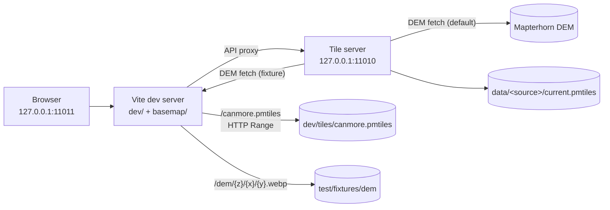

# 3. Dev harness

The development harness is a local Vite and MapLibre application that renders the vendored
Canmore–Banff basemap and the outdoor layers served by the tile server. It exists to preview tiles,
inspect layer styling and catch integration regressions without any external service.

## Purpose

- Render a small, offline vector-tile extract of Canmore and Banff.
- Toggle the `pois`, `routes`, `paths` and `contours` sources served by the local tile server.
- Exercise the same TileJSON and tile endpoints used in production.
- Provide a deterministic browser smoke test for the rendered map and its assets.

The harness is not a production frontend. It is a development tool that lives under `dev/` and is
never part of the server process.

## Layout

| Path                          | Purpose                                                                      |
| ----------------------------- | ---------------------------------------------------------------------------- |
| `dev/index.html`              | Full-screen map and the compact source panel.                                |
| `dev/src/main.js`             | MapLibre setup, PMTiles protocol, source catalogue and layer toggles.        |
| `dev/src/layers.js`           | Pure builders for POIs, routes, paths and contours, plus add/remove helpers. |
| `dev/src/style.css`           | Minimal harness presentation.                                                |
| `dev/basemap/`                | Vendored style, glyphs, sprites, notices and licence texts.                  |
| `dev/tiles/canmore.pmtiles`   | Local PMTiles extract served by the Vite range plugin.                       |
| `dev/vite-plugin-pmtiles.mjs` | HTTP Range handler and `parseRange()` used by Vite during development.       |
| `dev/vite-plugin-dem.mjs`     | Serves the committed DEM fixture at `/dem/{z}/{x}/{y}.webp`.                 |
| `test/fixtures/dem/`          | Committed 3×3 zoom 12 Mapterhorn DEM fixture used by the browser test.       |
| `vite.config.js`              | Vite root, public directory, ports, API proxy and plugins.                   |
| `playwright.config.js`        | Browser smoke-test servers, viewport and output locations.                   |

The Vite root is `dev/`, so `dev/basemap/` is the public directory and its `style.json`, fonts,
sprites and licence files are served from the site root. `dev/src/main.js` rewrites the basemap
source URL to `pmtiles://<origin>/canmore.pmtiles` and makes the local glyph and sprite paths
absolute; those assets remain local. It also moves the style attribution onto the rendered vector
source.

## Running

```sh
npm install
npm run dev
```

`npm run dev` runs two processes together with `concurrently`:

- `npm run dev:server` starts the tile server in watch mode on `127.0.0.1:11010`.
- `npm run dev:harness` starts Vite on `127.0.0.1:11011`.

Open <http://127.0.0.1:11011>. The tile server API remains available directly at
<http://127.0.0.1:11010>, and Vite proxies `/health`, `/ready`, `/sources`, `/pois`, `/routes`,
`/paths` and `/contours` to it.

Run either process separately when needed:

```sh
npm run dev:server
npm run dev:harness
```

The harness requires Node.js 24. Archives under `data/` are not committed, so the `pois`, `routes` and
`paths` toggles start disabled and report `unavailable` until an archive is supplied. The `contours`
toggle reports `available` on a fresh checkout and is enabled automatically because it needs no
archive; its tile requests use the `demUrl` in the active manifest. The Playwright fixture points at
the committed DEM block instead of Mapterhorn; see [Contour fixture](#contour-fixture).

### Ports

| Service      | Address           |
| ------------ | ----------------- |
| Tile server  | `127.0.0.1:11010` |
| Vite harness | `127.0.0.1:11011` |

The Playwright smoke test starts its own tile server and harness on `11012` and `11013`. Do not use
ports `11000` or `5174`; they belong to other local services. Vite uses `strictPort: true`, so a busy
harness port fails immediately rather than silently moving.



Requests for `/style.json`, fonts and sprites are served by Vite from `dev/basemap/`. Basemap tiles
arrive through the `pmtiles://` protocol: the browser asks Vite for byte ranges, Vite streams them
from the local archive, and the PMTiles client assembles the vector tiles in the browser. Outdoor
PMTiles layers use the tile server through the Vite proxy. Contours use the tile server too and
follow the `demUrl` in the active manifest. In the Playwright fixture that URL points at the Vite
`/dem` plugin, which closes the loop locally; the default development manifest uses Mapterhorn.

## Basemap provenance

The basemap is vendored, not downloaded at runtime. `dev/basemap/manifest.json` records the source
and checksums.

| Item                    | Value                                                                         |
| ----------------------- | ----------------------------------------------------------------------------- |
| Style repository        | <https://github.com/OpenGIS/basemap>                                          |
| Style commit            | `c17627d5b841d896f1cb3592074b8b69a4e37939`                                    |
| Style SHA-256           | `75ac376e5be89322c80ad65a58f583b924783757df12c3ca76aa23575dfe7449`            |
| Sprite JSON SHA-256     | `8a31c50b34ef12bad67ecfda74439e34cd2625ca0a2aac1d2f0c2b08d6bf0987`            |
| Sprite PNG SHA-256      | `6682c867b28288b3fd1ef70a517230ab486760c358c60904f0e2c89372f0bf24`            |
| Sprite @2x JSON SHA-256 | `70392721654a7cc6b5af42b09397272b3db455b7b002dab4f2e6099829acc329`            |
| Sprite @2x PNG SHA-256  | `2b1dc9319bf458a0391baa914a2805cfbe554210293bb034e9e41eb4d647a4ce`            |
| Tile provider           | OpenFreeMap                                                                   |
| OpenFreeMap version     | `20261025_080012_pt`                                                          |
| Source archive          | `https://btrfs.openfreemap.com/areas/planet/20261025_080012_pt/tiles.pmtiles` |
| Source SHA-256          | `35eaa415fcf4aa8f8740734d296ab35197cb5330d911aa2801e0aabeef491067`            |
| Extract path            | `dev/tiles/canmore.pmtiles`                                                   |
| Extract SHA-256         | `85626527dc20a09be831691051e38dc98a7e95ae4415da86a3daa7fe1b3588ac`            |
| Extract bounding box    | `-115.65, 50.95, -115.05, 51.35`                                              |
| Zoom range              | 0–14                                                                          |
| Tile count              | 1168                                                                          |
| Extract size            | 5,358,503 bytes                                                               |
| PMTiles CLI             | 1.31.2                                                                        |
| Default centre and zoom | `[-115.35, 51.15]`, zoom `12`                                                 |

The extract was produced with:

```sh
pmtiles extract \
  --bbox=-115.65,50.95,-115.05,51.35 \
  --maxzoom=14 \
  --download-threads=4 \
  https://btrfs.openfreemap.com/areas/planet/20261025_080012_pt/tiles.pmtiles \
  dev/tiles/canmore.pmtiles
```

The vendored font stacks are the combinations used by the style. Only the `0-255`, `256-511` and
`8192-8447` ranges are included; the map centre and zoom are chosen to keep the rendered labels
within those ranges.

## Updating the basemap

1. Choose an OpenFreeMap planet version and note its source URL and SHA-256.
2. Re-run the `pmtiles extract` command with the desired bounding box and maximum zoom.
3. Verify the result with `pmtiles verify dev/tiles/canmore.pmtiles`.
4. Update the extract SHA-256, byte size, tile count and version in
   `dev/basemap/manifest.json`.
5. Refresh the style, sprites and fonts from the pinned OpenGIS/basemap commit if the style
   changes, and update the recorded checksums.
6. Update this page when the provenance or commands change.
7. Run `npm test` and `npm run test:e2e`.

Do not regenerate the basemap for unrelated changes. The vendored extract keeps the harness
offline and the browser test deterministic.

## Contour fixture

The Playwright manifest is
[`test/fixtures/harness-layers.json`](../test/fixtures/harness-layers.json). Its `contours` source is
identical to the shipped source except for `demUrl`, which points at
`http://127.0.0.1:11013/dem/{z}/{x}/{y}.webp`.

The Vite `/dem` plugin serves `test/fixtures/dem/` with the same route shape as a real DEM provider
and returns `404` for anything outside the committed 3×3 block. The fixture is nine zoom 12
Mapterhorn WebP tiles at x `734–736`, y `1367–1369`, about 960 KiB (979 KB) in total. The central tile
(`12/735/1368`) has all eight neighbours, so contours render in one central block. The other eight
tiles fetch neighbours outside the fixture and return `204`, which is the expected fixture boundary
rather than a rendering failure.

The contour layer draws line features from the `contours` source layer. `level: 0` is a minor line
(`#c2b19a`, width 0.7) and `level: 1` is a major line (`#8a6a48`, width 1.4); line opacity is 0.75.
The layer is inserted below the first basemap symbol layer.

## Offline and deterministic behaviour

The Playwright run is offline and deterministic:

- All styles, glyphs, sprites, licences, basemap tiles and DEM tiles are local.
- The browser test makes no external network requests.
- The Playwright fixture manifest points at non-existent archives under `test/fixtures/empty/` for
  `pois`, `routes` and `paths`, so a test-started server begins with those three sources unavailable.
  `contours` uses the local DEM fixture and is available.
- The test allows only `127.0.0.1`, `localhost`, `blob:` and `data:` URLs and fails on any external
  request.
- The tile server is started from the test fixture with `CONFIG_PATH`, so it does not depend on a
  developer's `data/` directory.

## Playwright smoke test

```sh
npm run test:e2e
```

The Playwright configuration starts the tile server and Vite itself, using ports `11012` and
`11013`, and reuses an existing local server when one is already listening; CI never reuses them.
The test:

1. waits for `body[data-map-ready="true"]` and asserts there is no `data-map-error`;
2. waits for `#sources[data-sources-ready="true"]`;
3. asserts the `pois`, `routes`, `paths` and `contours` checkboxes are visible;
4. asserts `pois`, `routes` and `paths` are disabled and report `unavailable`, while `contours` is
   enabled, checked and reports `available`;
5. waits for `body[data-contour-layer="true"]`;
6. checks that the MapLibre canvas is visible and the attribution names OpenFreeMap, OpenStreetMap
   and Mapterhorn;
7. saves a full-page screenshot named `harness.png` in the configured Playwright output
   directory;
8. fails on console errors, page errors, failed HTTP responses or external requests;
9. asserts that at least one `/contours/{z}/{x}/{y}.pbf` response returned `200` with a non-zero
   `Content-Length`.

The screenshot is visual evidence for a review, not a pixel baseline. The test does not use
`toHaveScreenshot`, so it remains stable across platforms. The current capture is at
`tmp/playwright/harness-renders-the-offline-basemap-harness/harness.png`.

An independent visual check of that capture confirms brown contour linework over Princess Margaret
Mountain, Bald Eagle Peak and Mount Charles Stewart, a four-source panel and the attribution string
`Mapterhorn | MapLibre | OpenFreeMap © OpenMapTiles Data from OpenStreetMap`.

## Licensing

- `dev/basemap/NOTICE` records the third-party components and their licences.
- `dev/basemap/LICENSES/` holds the ODbL-1.0, Apache-2.0, OFL-1.1, BSD-3-Clause and MIT texts plus
  the OpenMapTiles licence, which covers BSD-3-Clause code and CC BY 4.0 cartography; the CC BY 4.0
  legal code is linked rather than duplicated.
- OpenStreetMap-derived data, including the OpenFreeMap tiles, is available under the Open
  Database Licence (ODbL). Attribution must remain visible.
- The OpenMapTiles cartography is licensed under CC BY 4.0.
- The vendored fonts are licensed under Apache-2.0 (Open Sans) and OFL-1.1 (Noto Sans).
- MapLibre GL JS is licensed under BSD-3-Clause.
- Mapterhorn DEM attribution is required. The fixture manifest records the source and attribution;
  see the [Mapterhorn attribution page](https://mapterhorn.com/attribution).
- Runtime contour dependencies and their licences are listed in
  [`THIRD_PARTY_NOTICES.md`](../THIRD_PARTY_NOTICES.md).

The map's attribution control displays the basemap and source attributions. When a source is
toggled on, its catalogue attribution is attached to the MapLibre vector source and rendered by
the same control.

## Related documentation

- [Architecture](2.architecture.md) — the tile server contract and data layout.
- [Contours](4.contours.md) — contour generation, configuration and failure semantics.
- [Documentation index](README.md)
- [Project README](../README.md)
