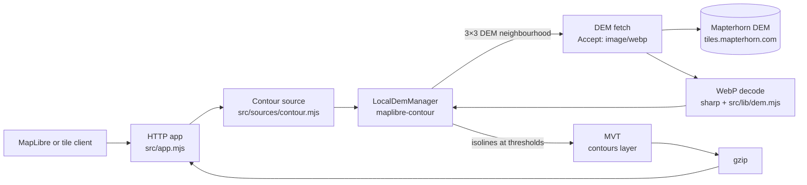

# 4. Contours

> On-demand contour lines generated from a remote elevation model and served as gzipped Mapbox Vector
> Tiles.

## Purpose

The `contours` source adds terrain contour lines without storing or building contour archives. For
each requested tile, the server fetches a small neighbourhood of elevation tiles from a DEM provider,
derives isolines at zoom-dependent intervals and returns a normal vector tile. The layer is
worldwide and configurable at the cost of a per-tile upstream dependency.

The source is implemented in [`src/sources/contour.mjs`](../src/sources/contour.mjs), with WebP
decoding in [`src/lib/dem.mjs`](../src/lib/dem.mjs). It uses `maplibre-contour` and `sharp`; see
[Third-party notices](../THIRD_PARTY_NOTICES.md) for licences.

## Data flow



1. The HTTP layer resolves `GET /contours/{z}/{x}/{y}.pbf` and rejects versioned contour URLs.
2. A zoom guard returns an empty tile when `z` is outside the configured range, without fetching
   anything upstream.
3. The zoom-specific threshold interval is selected.
4. `maplibre-contour`'s `LocalDemManager` requests the 3×3 neighbourhood of DEM tiles around the
   requested tile. The extra ring keeps contour lines continuous across tile edges.
5. Each DEM tile is fetched with `Accept: image/webp`, a per-request timeout and a 5 MiB body cap.
6. `sharp` decodes the WebP to raw RGBA. The decoder checks the WebP signature and requires the
   image dimensions to equal `demTileSize`.
7. `maplibre-contour` converts the RGB channels to a `Float32Array` of elevations using the
   configured encoding.
8. The neighbourhood is assembled into a virtual tile and passed to `d3-contour`. Any missing
   neighbour makes the whole contour tile empty.
9. The MVT is encoded in the configured layer with `ele` and `level` properties, then gzip-compressed.
10. The HTTP layer sends the gzip bytes when the client accepts gzip, or decompresses once to
    identity.

## Configuration

The shipped source in [`config/layers.json`](../config/layers.json):

```json
{
  "kind": "contour",
  "title": "Terrain contours",
  "description": "Contour lines generated on demand from a worldwide elevation model.",
  "attribution": [{ "title": "Mapterhorn", "href": "https://mapterhorn.com/attribution" }],
  "minzoom": 1,
  "maxzoom": 15,
  "demUrl": "https://tiles.mapterhorn.com/{z}/{x}/{y}.webp",
  "encoding": "terrarium",
  "demMaxzoom": 12,
  "demTileSize": 512,
  "cacheSize": 100,
  "timeoutMs": 10000,
  "buffer": 1,
  "extent": 4096,
  "contourLayer": "contours",
  "elevationKey": "ele",
  "levelKey": "level",
  "cacheMaxAge": 86400,
  "thresholds": {
    "1": [600, 3000],
    "4": [300, 1500],
    "8": [150, 750],
    "9": [80, 400],
    "10": [20, 100],
    "11": [20, 100],
    "12": [20, 100],
    "13": [10, 50],
    "14": [5, 25]
  }
}
```

| Field          | Requirement and default                                                                                                                                     |
| -------------- | ----------------------------------------------------------------------------------------------------------------------------------------------------------- |
| `kind`         | Required; must be `contour`.                                                                                                                                |
| `title`        | Required non-empty string. Used as the TileJSON name and catalogue title.                                                                                   |
| `description`  | Required non-empty string.                                                                                                                                  |
| `attribution`  | Required array of `{ title, href }` objects. `href` must be an absolute `http` or `https` URL. The array may be empty.                                      |
| `minzoom`      | Required integer from 1 to 15.                                                                                                                              |
| `maxzoom`      | Required integer from 1 to 15, greater than or equal to `minzoom`.                                                                                          |
| `demUrl`       | Required absolute `http` or `https` URL containing `{z}`, `{x}` and `{y}`.                                                                                  |
| `encoding`     | Required; `terrarium` or `mapbox`. The shipped source uses `terrarium`.                                                                                     |
| `demMaxzoom`   | Optional integer from 0 to 17, default `12`. It must not exceed `maxzoom`.                                                                                  |
| `demTileSize`  | Optional integer from 256 to 2048, default `512`. Every fetched image must match it exactly.                                                                |
| `cacheSize`    | Optional integer from 1 to 1000, default `100`. Maximum entries in each `LocalDemManager` cache.                                                            |
| `timeoutMs`    | Optional integer from 1000 to 60000, default `10000`. Per-DEM-tile request timeout.                                                                         |
| `buffer`       | Optional integer from 0 to 64, default `1`. Passed to contour generation as the tile buffer.                                                                |
| `extent`       | Optional integer from 256 to 8192, default `4096`. MVT extent.                                                                                              |
| `contourLayer` | Optional non-empty string, default `contours`. MVT layer name.                                                                                              |
| `elevationKey` | Optional non-empty string, default `ele`. Elevation property in metres.                                                                                     |
| `levelKey`     | Optional non-empty string, default `level`. 0 for a minor contour, 1 for a major contour.                                                                   |
| `cacheMaxAge`  | Optional integer from 60 to 86400, default `86400`. Used in `Cache-Control` for unversioned contour tiles.                                                  |
| `thresholds`   | Required object with at least one entry. Keys are canonical decimal zooms from 0 to 26; values are `[minor, major]` positive integers with `minor < major`. |

Unknown keys are rejected. Contour sources reject `archiveDir`, and PMTiles sources reject every
contour-only field. `multiplier` is fixed at `1`, so all elevations and thresholds are in metres.

### Build ID

The build ID is the first twelve hexadecimal characters of a SHA-256 hash over `demUrl`, `encoding`,
`demMaxzoom`, `demTileSize`, `thresholds`, `buffer`, `extent`, `contourLayer`, `elevationKey`,
`levelKey`, `minzoom` and `maxzoom`. Threshold key order is normalised before hashing. `cacheSize`,
`timeoutMs` and `cacheMaxAge` are excluded because they do not change tile content.

The build ID is reported by `/health` and `/sources`, and appears in tile ETags. Because contour
tiles are not versioned, the build ID is diagnostic rather than a URL segment.

## Thresholds

The threshold table is a step function. The highest entry at or below the requested zoom applies;
zooms between configured entries reuse the lower entry, and zooms below the first entry reuse the
first entry.

| Contour zoom | Minor interval | Major interval |
| ------------ | -------------- | -------------- |
| 1            | 600 m          | 3000 m         |
| 4            | 300 m          | 1500 m         |
| 8            | 150 m          | 750 m          |
| 9            | 80 m           | 400 m          |
| 10           | 20 m           | 100 m          |
| 11           | 20 m           | 100 m          |
| 12           | 20 m           | 100 m          |
| 13           | 10 m           | 50 m           |
| 14           | 5 m            | 25 m           |

Zooms 2–3 use the zoom 1 intervals, 5–7 use zoom 4, and 15 uses zoom 14. Contour lines are produced
at multiples of the minor interval; a line that is also a multiple of the major interval gets
`level: 1`, otherwise `level: 0`. The `ele` property carries the elevation in metres. The harness uses
`level` to style major lines darker and wider.

## DEM provider and encoding

The shipped source uses [Mapterhorn](https://mapterhorn.com/attribution) at
`https://tiles.mapterhorn.com/{z}/{x}/{y}.webp`, with 512-pixel WebP tiles in terrarium encoding.
`demMaxzoom` is 12, so zooms 13–15 reuse the zoom 12 DEM and split it into smaller virtual tiles.
DEM requests are clamped to `demMaxzoom`.

Terrarium decoding is `R × 256 + G + B / 256 − 32768`. The alternative `mapbox` encoding is
`−10000 + (R × 65536 + G × 256 + B) × 0.1`. Only WebP is decoded; PNG, LERC and other DEM formats are
not supported.

Each contour tile needs the full 3×3 neighbourhood. If any neighbour is missing, the source returns an
empty tile instead of filling missing elevation with sea level, which would draw false 0 m contours.

## Failure semantics

| Condition                                                       | Result                                                                      |
| --------------------------------------------------------------- | --------------------------------------------------------------------------- |
| DEM tile returns `204`, `404` or `410`                          | `204` empty contour tile with an `-empty` ETag; normal contour cache policy |
| DEM returns `429` or any `5xx`                                  | `503 upstream_unavailable` with `Retry-After`                               |
| DEM returns another non-success status (for example `403`)      | `503 upstream_unavailable` with `Retry-After: 60`                           |
| Network failure or `timeoutMs` expiry                           | `503 upstream_unavailable` with `Retry-After: 60`                           |
| WebP magic, image dimensions or decode failure                  | `500 internal_error`                                                        |
| DEM body exceeds 5 MiB, by `Content-Length` or streaming length | `500 internal_error`                                                        |
| Requested zoom outside the configured range                     | `204` empty tile without an upstream fetch                                  |
| Versioned contour URL                                           | `404 not_found`                                                             |
| Client disconnects                                              | The DEM fetch is aborted and no response is written                         |

`Retry-After` uses the upstream header when it is a positive integer number of seconds and falls back
to `60` otherwise. `500` responses never include decode details, a stack trace or the upstream URL.
A coverage failure is not an error: it is a normal empty tile and is cacheable like any other contour
tile.

## Zoom and overzoom

`minzoom` and `maxzoom` are both constrained to 1–15. Requests below `minzoom` or above `maxzoom`
return `204` without contacting the DEM provider. `demMaxzoom` can be lower than `maxzoom`; missing
DEM zooms are overzoomed by splitting the parent tile. The source does not use `maplibre-contour`'s
`overzoom` option directly; the manager's `maxzoom` clamp provides the same effect.

## Caching, ETag and versioning

- `LocalDemManager` keeps three bounded in-memory caches — raw DEM tiles, parsed DEM tiles and
  generated contour tiles — each holding up to `cacheSize` entries. The cache is per process and is
  cleared when the source closes. There is no disk cache and no shared cache between processes.
- Contour tiles always use `Cache-Control: public, max-age=<cacheMaxAge>`. The shipped value is
  `86400` (one day), and the header is **not** immutable because the source follows configuration
  and upstream data rather than a fixed archive.
- TileJSON uses the normal short TTL, `public, max-age=300`.
- ETags follow the same shape as PMTiles tiles: `"<buildId>-<z>-<x>-<y>-gzip"`,
  `"<buildId>-<z>-<x>-<y>-identity"` or `"<buildId>-<z>-<x>-<y>-empty"`. A matching `If-None-Match`
  returns `304`.
- Contour tiles are unversioned only. `/contours/{z}/{x}/{y}.pbf` is the only tile route;
  `/contours/<buildId>/{z}/{x}/{y}.pbf` returns `404`. TileJSON advertises the unversioned URL.
- Changing a hashed configuration field changes the build ID, and therefore every ETag. Changing
  `cacheSize`, `timeoutMs` or `cacheMaxAge` does not.

Generated contour tiles are always gzip-compressed, so successful non-empty responses carry
`Vary: Accept-Encoding`. Empty tiles carry no `Content-Encoding` and no `Vary`.

## Health and readiness

A contour source is constructed available and performs no network request at startup. `/health`
reports `available: true` and the configuration build ID. `/health` is `ok` only when every source is
available; on a fresh checkout the three PMTiles sources are missing, so it reports `degraded` while
still showing `contours` as available.

`/ready` is a local readiness check. It reports `503` with the names of unavailable local sources and
never probes Mapterhorn, so an upstream outage does not remove the process from a load balancer.
Upstream failures are visible as `503 upstream_unavailable` on individual tile requests.

## Testing and fixtures

- [`test/unit/contour.test.js`](../test/unit/contour.test.js) covers build-ID stability, threshold
  selection, zoom guards, gzip output, decoding and the error mappings.
- [`test/unit/dem.test.js`](../test/unit/dem.test.js) covers the WebP decoder, including bad magic
  bytes, wrong dimensions and corrupt images.
- [`test/integration/contour.test.js`](../test/integration/contour.test.js) runs a real HTTP server
  against a local DEM server. It checks TileJSON, gzip and identity negotiation, `304`, empty-tile
  responses, the versioned `404`, `HEAD`, `OPTIONS`, `503` with `Retry-After`, `500` for corrupt
  images, client-disconnect aborts, and health/readiness/catalogue responses.
- [`test/unit/config.test.js`](../test/unit/config.test.js) covers contour defaults, bounds, rejected
  keys and threshold validation.

The committed DEM fixture is a 3×3 block of zoom 12 Mapterhorn tiles centred on Canmore, Alberta:
`test/fixtures/dem/12/{734,735,736}/{1367,1368,1369}.webp`, about 960 KiB (979 KB) in total. Its
[manifest](../test/fixtures/dem/manifest.json) records the source URL, bounding box, byte size and
SHA-256 for every tile, plus the Mapterhorn attribution. Only the central tile has full neighbour
coverage; the surrounding eight tiles are present so the central tile can generate contours, but
their own neighbourhoods extend beyond the fixture and therefore return empty tiles.

The development harness serves the fixture through the Vite `/dem/{z}/{x}/{y}.webp` plugin and
asserts that at least one real contour tile returns `200` with a non-zero body. See
[3. Dev harness](3.dev-harness.md#contour-fixture).

## Harness

The harness automatically enables `contours` when the catalogue reports it as available. In the
Playwright fixture, `demUrl` points at the Vite harness rather than Mapterhorn:

```json
"demUrl": "http://127.0.0.1:11011/dem/{z}/{x}/{y}.webp"
```

Contours render in a central block around the map centre, with 204 responses at the fixture boundary.
The browser test also checks the panel, attribution, console and network errors, and saves a
screenshot. The capture lives at
`tmp/playwright/harness-renders-the-offline-basemap-harness/harness.png`.

## Attribution and licences

- Mapterhorn attribution is required and is part of the source's catalogue attribution. It remains
  visible in the harness and in TileJSON. See the
  [Mapterhorn attribution page](https://mapterhorn.com/attribution) for upstream data sources and
  terms.
- OpenStreetMap-derived data is available under the Open Database Licence (ODbL). The vendored
  basemap notices live in [`dev/basemap/NOTICE`](../dev/basemap/NOTICE).
- `maplibre-contour` is BSD-3-Clause and includes d3-contour (ISC) and vt-pbf (MIT) code. `sharp` is
  Apache-2.0; its prebuilt packages bundle libvips under the LGPL. Full notices are in
  [Third-party notices](../THIRD_PARTY_NOTICES.md).
- The project has no root `LICENSE` or `NOTICE` file; the code licence is not yet decided.

## Related

- [2. Architecture](2.architecture.md) — manifest, data layout and HTTP contract.
- [3. Dev harness](3.dev-harness.md) — the local harness and contour fixture.
- [Documentation index](README.md)
- [Project README](../README.md)
