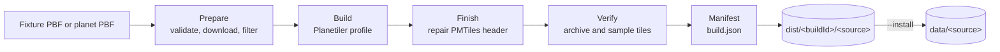

# 5. Build pipelines

> The `ogis build` command that turns an OpenStreetMap PBF into verified, content-addressed PMTiles
> archives for the `pois`, `routes` and `paths` sources.

The build pipeline is implemented by [`bin/ogis.mjs`](../bin/ogis.mjs) and
[`src/build/`](../src/build/). It reads the same [`config/layers.json`](../config/layers.json) as the
server, builds every selected `pmtiles` source that declares a `build` block, verifies the result and
optionally installs it under `data/`. Contours are generated on demand and are not built.

The builder is a separate process. The serving core never invokes it and does not read `dist/`; it
only opens the archives installed under `data/<source>/`. The relationship between the two is covered
in [2. Architecture](2.architecture.md#build-pipeline).

## Command

```sh
node bin/ogis.mjs build [options]
# or, through the package script:
npm run build:tiles -- [options]
```

`--help` prints the full option list. Options accept either `--flag=value` or `--flag value`; boolean
flags take no value.

| Flag                         | Value                | Effect                                                                                     |
| ---------------------------- | -------------------- | ------------------------------------------------------------------------------------------ |
| `--only`                     | comma-separated list | Build only the named sources. Every name must declare a build profile.                     |
| `--fixture`                  | PBF path             | Build in fixture mode from a local PBF instead of the planet.                              |
| `--planet-pbf`               | PBF path             | Build in planet mode from a local planet PBF. A pinned SHA-256 is still required.          |
| `--planet-url`               | URL                  | Override the configured planet download URL.                                               |
| `--planet-date`              | `YYYY-MM-DD`         | Override the planet date.                                                                  |
| `--planet-sha256`            | 64 hex characters    | Override the pinned planet SHA-256.                                                        |
| `--skip-download`            | none                 | Do not download the planet; fail unless the cached PBF already exists.                     |
| `--skip-filter`              | none                 | Build directly from the input PBF with no osmium filtering.                                |
| `--skip-build`               | none                 | Verify and manifest an existing archive instead of building one.                           |
| `--archive`                  | PMTiles path         | Archive to use with `--skip-build`. Without it, the newest existing build is reused.       |
| `--skip-verify`              | none                 | Skip `pmtiles verify` and sample-tile decoding; still inspect size, tiles and compression. |
| `--output-dir`               | relative path        | Override the build output directory. Absolute paths and `..` segments are rejected.        |
| `--install`                  | none                 | Install the built archives into their configured `data/<source>/` directories afterwards.  |
| `--allow-unverified-install` | none                 | Permit `--install` when verification was skipped.                                          |
| `--keep-work`                | none                 | Keep the temporary work directory for inspection.                                          |
| `--force`                    | none                 | Download the planet and Planetiler jar again. Cannot be combined with `--skip-download`.   |

Environment fallbacks are `CONFIG_PATH` (manifest path), `PLANET_URL`, `PLANET_DATE` and
`PLANET_SHA256`. Command-line values win over the environment, which wins over the manifest. The
fixture date is the exception: an adjacent fixture manifest supplies the extract date before the
flags are considered. Its checksum is used only when no flag or environment override is set.

By default the command selects every source with a `build` block — `pois`, `routes` and `paths`.
`contours` has no build block and is never selected.

Typical local runs:

```sh
# Build all three sources from the committed fixture, leaving output under dist/
npm run build:tiles -- --fixture=test/fixtures/alberta-canmore.osm.pbf

# Build one source into a scratch directory
npm run build:tiles -- --fixture=test/fixtures/alberta-canmore.osm.pbf \
  --only=paths --output-dir=tmp/build

# Build and promote into data/paths/
npm run build:tiles -- --fixture=test/fixtures/alberta-canmore.osm.pbf \
  --only=paths --install
```

## Stages



Each selected source runs the cycle independently. The planet download is cached and reused, but the
filter and Planetiler build are repeated per source; the run is sequential rather than parallel.

### 1. Prepare

The input is resolved in one of three ways:

- **Fixture** — `--fixture` points at a local PBF. A sibling manifest named by replacing `.osm.pbf`
  with `.manifest.json` is read when present and supplies the source URL, extract date and SHA-256.
  A checksum override from `--planet-sha256` or `PLANET_SHA256` must match the fixture bytes.
- **Local planet** — `--planet-pbf` points at a local planet PBF. The pinned SHA-256 is mandatory
  and the file is hashed before use.
- **Downloaded planet** — the URL comes from `--planet-url`, `PLANET_URL` or `build.planet.url`. The
  archive is downloaded to `tmp/planet/`, written to a `.part` file and renamed only after its
  SHA-256 matches. A cached file is hashed again on every run. `--force` downloads it again;
  `--skip-download` requires the cached file to exist.

A planet build also requires a real calendar date. The fixture build takes its date from the fixture
manifest when present; otherwise the flag, environment or manifest value is used, and an empty date
is allowed. The resolved input is checked with `osmium fileinfo -e` before anything is filtered or
built.

The toolchain is then detected (see [Toolchain and pins](#toolchain-and-pins)), and the Planetiler
jar is downloaded or reused from `tmp/tools/` with its pinned SHA-256 verified.

### 2. Filter

All sources share one filter union. The union is computed from every source's `expressions` array,
including sources not selected by `--only`; the rendered file is hashed into the manifest. The
shipped manifest produces 25 unique expressions (see [Shared filter union](#shared-filter-union)).

The filter runs as two osmium passes:

```sh
osmium tags-filter -O -e expressions.txt -t input.osm.pbf -o tagged.osm.pbf
osmium cat -O -c version -c changeset -c timestamp -c uid -c user tagged.osm.pbf \
  -o filtered.osm.pbf
```

`tags-filter` writes matching objects plus the objects they reference; `-t` removes tags from
referenced objects that did not match, so relation member ways survive without polluting the filter.
The `cat` pass strips version, changeset, timestamp, uid and user metadata. `--skip-filter` builds
directly from the input PBF and records `filter.applied: false` and `filter.skipped: true`.

### 3. Build

Planetiler writes `current.partial.pmtiles` in the staging directory. YAML profiles use the built-in
`generate-custom` schema runner:

```sh
java -jar tmp/tools/planetiler-0.10.2.jar generate-custom \
  --schema=build/profiles/pois.yml \
  --osm_path=<filtered.pbf> \
  --output=<current.partial.pmtiles> \
  --tmpdir=<work>/planetiler-tmp \
  --minzoom=0 --maxzoom=16 \
  --force --use_wikidata=false
```

Java profiles use Java source-file mode with the Planetiler jar on the classpath. The heap comes from
the source's `build.heap` (default `2g`), and the thread count is the host's available parallelism:

```sh
java -Xmx2g -cp tmp/tools/planetiler-0.10.2.jar build/profiles/routes.java \
  --osm_path=<filtered.pbf> \
  --download=false \
  --minzoom=8 --maxzoom=14 \
  --nodemap-type=array --nodemap-storage=mmap --storage=mmap \
  --threads=<availableParallelism> \
  --tmpdir=<work>/planetiler-tmp \
  --output=<current.partial.pmtiles> \
  --force
```

The Java command always passes `--download=false`; the PBF is already local. The YAML path always
disables Wikidata lookups. Both modes get the build zoom range from `config/layers.json`.

### 4. Finish

Custom Planetiler builds can emit an incorrect `minzoom` or centre in the PMTiles header. The finish
stage reads the header with `pmtiles show --header-json`, repairs it and writes it back with
`pmtiles edit --header-json`:

- For a YAML profile, `minzoom` is the lowest `min_zoom` declared in the schema. For the POI profile
  that is 12, even though Planetiler is invoked with `minzoom=0`.
- For a Java profile, `minzoom` is read from the archive header using the in-repo PMTiles reader.
- The centre zoom is clamped to the repaired zoom range, and the centre coordinates must lie inside
  the header bounds.

Only the header changes; tile data is untouched.

### 5. Verify

Verification runs `pmtiles verify` and requires a success marker in its output. It then checks:

- the archive size is at least the configured floor for the build mode;
- `pmtiles show` reports at least one addressed tile and gzip tile compression;
- archive metadata is readable (metadata failures are recorded, not fatal);
- every configured sample tile decodes as an MVT with at least one feature in the verification layer,
  the required geometry when configured, and the required attributes somewhere in that layer.

`--skip-verify` still inspects the size, tile count, compression and metadata, but skips `pmtiles
verify` and sample decoding. The manifest records `verification.ok: false` and `skipped: true`, and
`--install` refuses the archive unless `--allow-unverified-install` is also set. The detailed table
is in [Verification](#verification).

### 6. Manifest

A verified archive is renamed to `current.pmtiles` and hashed. The hash determines the build ID, and
the manifest is written beside the archive as `build.json`. The manifest records the input
provenance, fixture or planet details, tool versions and checksums, profile and filter hashes, skip
flags, verification results, sample tiles, archive hash, size and tile count, and the size floor.

## Profiles

Profiles live in [`build/profiles/`](../build/profiles/) and are selected by name from the source's
`build.profile`. A source can override the profile kind, file and heap, but the shipped manifest uses
the registered defaults.

### POIs — YAML

[`build/profiles/pois.yml`](../build/profiles/pois.yml) is a Planetiler YAML schema with 18 feature
rules and one layer, `outdoor_pois`. Every rule uses centroid geometry and starts at `min_zoom: 12`;
the archive is built to z16. The rules cover:

- huts (alpine and wilderness), shelters, viewpoints, campsites and picnic sites;
- drinking water, trailheads, saddles and ranger stations;
- castles, information points, parking, parks, toilets and playgrounds;
- ferry terminals, lighthouses and ski resorts.

Each rule defines `kind`, `name` and `ele`; `name` and `ele` are populated from the matching OSM
tags. `kind` is normalised where the OSM tag differs from the output vocabulary — for example
`natural=saddle` becomes `kind: pass`, `tourism=camp_site` becomes `kind: campsite`, and
`leisure=ski_resort` becomes `kind: skiing`.

The source config records `minzoom: 0` for the Planetiler invocation and `maxzoom: 16`. The finish
stage repairs the archive header to the profile's effective minimum of z12, so the server advertises
z12–16.

### Routes — Java

[`build/profiles/routes.java`](../build/profiles/routes.java) emits `outdoor_routes` line features
from z8 to z14. It handles two activities, in priority order:

| Activity  | `route` tokens              | Networks                   | Exclusions                                     |
| --------- | --------------------------- | -------------------------- | ---------------------------------------------- |
| `hiking`  | `hiking`, `foot`, `walking` | `iwn`, `nwn`, `rwn`, `lwn` | None.                                          |
| `cycling` | `bicycle`                   | `icn`, `ncn`, `rcn`, `lcn` | `state=proposed`; `network:type=node_network`. |

Relations of type `route` or `superroute` are matched by semicolon-separated `route` tokens. The full
set of surviving activities is stored on one relation-info record per relation, because Planetiler
keeps only one `OsmRelationInfo` per relation ID. `processFeature` then emits one feature per
activity, so a relation tagged `route=hiking;bicycle` produces both a hiking and a cycling feature.
The profile writes these attributes:

- `activity` — this feature's activity;
- `activities` — the full set in priority order, for example `hiking;cycling`;
- `network` — only when the relation's whole network value belongs to that activity's vocabulary;
- `name`, `ref`, `osmc_symbol`, `operator`, `distance`, `ascent`, `descent`, `cai_scale` and
  `roundtrip`.

Cycling exclusions are applied per activity: a proposed cycling relation drops cycling but can still
produce hiking if it matches. The network value is not split on semicolons; a value such as
`ncn;npn` does not match either vocabulary and is omitted. Short segments are retained for merging,
then `FeatureMerge.mergeLineStrings` joins touching ways with matching tags.

### Paths — Java

[`build/profiles/paths.java`](../build/profiles/paths.java) emits `outdoor_paths` line features from
z9 to z13 for ways tagged `highway=path`, `highway=footway` or `highway=track`. Hiking route network
tiers control how early a path appears:

| Best route membership | Minimum zoom |
| --------------------- | ------------ |
| `iwn`                 | 9            |
| `nwn`                 | 10           |
| `rwn`                 | 11           |
| `lwn`                 | 12           |
| none                  | 12           |

Every path appears by z12. The profile writes `class` (the matched highway value), `name`,
`sac_scale` and, when known, `network`. The lowest zoom among a way's route memberships wins. The lwn fix is
deliberate: a way whose best membership is `lwn` keeps `network=lwn` at z12 even though the tier does
not lower its minimum zoom. The earlier behaviour attached a network only when the tier lowered the
zoom, so lwn-only ways lost the attribute. Short segments are retained and merged in the same way as
routes.

## Shared filter union

The three sources contribute expressions as follows:

| Source   | Expressions | Contribution                                                                            |
| -------- | ----------- | --------------------------------------------------------------------------------------- |
| `pois`   | 18          | POI tag matches (`nwr/tourism=…`, `nwr/amenity=…`, `nwr/highway=trailhead`, and so on). |
| `routes` | 4           | `r/route=*hiking*`, `*bicycle*`, `*foot*` and `*walking*`.                              |
| `paths`  | 7           | The same four relation expressions plus `w/highway=path`, `footway` and `track`.        |

The four relation expressions are duplicated between `routes` and `paths`, so the union is 25 unique
expressions. The union is used for every source build, including a `--only` build, so the filtered
PBF always contains every source's context. The rendered file is one expression per line; its
SHA-256 and expression count are recorded in the manifest. Any change to an expression in any source
therefore changes the filter hash for all builds.

## Toolchain and pins

| Tool        | Requirement                                                                                  |
| ----------- | -------------------------------------------------------------------------------------------- |
| Node.js     | 24 or newer, as declared by `package.json`.                                                  |
| Java        | 21 or newer. The detected version and executable SHA-256 are recorded.                       |
| Planetiler  | 0.10.2, with the release URL and SHA-256 pinned in `config/layers.json`.                     |
| osmium      | Available on `PATH`. There is no version pin; the detected version and SHA-256 are recorded. |
| pmtiles CLI | 1.31.2 for planet builds. Fixture builds warn and continue with the installed binary.        |

The Planetiler jar is cached as `tmp/tools/planetiler-<version>.jar`. A cached jar is executed only
when its SHA-256 matches the pin; a mismatch fails unless `--force` is used. If no download URL is
configured, a valid cached jar is reused but cannot be force-refreshed.

The pmtiles check compares the CLI's reported version with `build.tools.pmtiles`. A fixture build
warns and uses the binary that is installed; a planet build stops. The build manifest records both
the actual version and the configured pin, plus the binary SHA-256.

## Output and build IDs

The default output directory is `dist`, from `build.outputDir`. A completed build is laid out as:

```text
dist/
└── <buildId>/
    └── <source>/
        ├── current.pmtiles
        └── build.json
```

Build IDs are content-addressed from the final archive bytes:

- `fixture-<12 lowercase hex>` — first twelve characters of the archive SHA-256.
- `<YYYYMMDD>-<12 lowercase hex>` — the planet date without separators, then the first twelve
  characters of the archive SHA-256.

Two builds that produce identical archive bytes share a build ID even if their run IDs differ. The
separate `runId` is a hash of the build recipe — source, zooms, planet date and SHA-256, profile and
filter hashes, skip flags and tool versions — and is used for the temporary work and staging
directories:

```text
tmp/work/<runId>/<source>/          # osmium output and Planetiler temporary files
tmp/tools/                          # cached Planetiler jar
tmp/planet/                         # cached planet PBF
dist/.staging/<runId>/<source>/     # archive and manifest before promotion
```

`--keep-work` leaves the work directory in place. Staging and work directories are removed on
success unless it is set, and on failure unless it is set.

The manifest's `archive.path` is `current.pmtiles` inside the build directory. Installation rewrites
it to the path relative to the installed data directory. The manifest also records the planet URL,
date and SHA-256 (or fixture provenance), tool versions, profile and filter hashes, skip flags,
verification layers and sample results.

## Install and rollback

`--install` runs after every selected source has built successfully. It promotes each archive into
its configured `archiveDir`, normally `data/<source>/`:

```text
data/pois/
├── current.pmtiles
├── current.json
├── previous.pmtiles
└── previous.json
```

- `current.json` and `previous.json` are the full build manifests, not just `{ "buildId": ... }`;
  the serving core reads only the `buildId` field.
- If the current archive and sidecar already describe the same build ID and archive SHA-256, the
  install is a no-op.
- If the current pair is valid and has a different build ID, it is rotated to `previous.pmtiles` and
  `previous.json`, and the new pair becomes current.
- If any step fails, all changed entries are rolled back: old current and previous files are
  restored and newly written temporary files are removed.
- Because sources are installed together, a failure on one source rolls back the other sources in
  the same `--install` run.

The server opens archives at startup and does not watch them. Restart the server after installing a
new archive for the new build ID and tiles to become visible.

## Verification

Verification is configured per source in `build.verification` and `build.sampleTiles`. The shipped
rules are:

| Source   | Layer            | Geometry | Required attributes      | Fixture floor | Planet floor |
| -------- | ---------------- | -------- | ------------------------ | ------------- | ------------ |
| `pois`   | `outdoor_pois`   | —        | `kind`, `name`           | 4 KiB         | 100 MiB      |
| `routes` | `outdoor_routes` | line     | `activity`, `activities` | 64 KiB        | 100 MiB      |
| `paths`  | `outdoor_paths`  | line     | `class`, `network`       | 128 KiB       | 100 MiB      |

The geometry and attribute checks are presence checks on the decoded sample layer, not per-feature
requirements. A layer passes when it has at least one feature, at least one feature of the configured
geometry when one is set, and at least one feature carrying each required attribute. The POI profile
does not configure a geometry check; the build test additionally asserts that its samples contain
points.

The build suite adds two regressions beyond the per-archive checks:

- **Dual-activity routes** — a synthetic OSM XML with a `route=hiking;bicycle` relation is built with
  the routes profile. It must emit two features with `activities=hiking;cycling`, keep the hiking
  activity when cycling is excluded, and preserve whole network values.
- **Paths lwn** — the fixture's Stoney Lookout Trail must carry `class=path` and `network=lwn`. This
  is the regression for the lwn fix described in [Profiles](#profiles).

## Fixture and test split

The end-to-end build fixture is [`test/fixtures/alberta-canmore.osm.pbf`](../test/fixtures/alberta-canmore.osm.pbf),
with provenance in `alberta-canmore.manifest.json`:

| Item         | Value                                                                |
| ------------ | -------------------------------------------------------------------- |
| Source       | Geofabrik Alberta extract                                            |
| Bounding box | `-115.65,50.95,-115.05,51.35`                                        |
| Extract date | 2026-10-29                                                           |
| Licence      | ODbL-1.0                                                             |
| Layer data   | Canmore and Banff outdoor POIs, hiking and cycling routes, and paths |

The fixture is clipped from Alberta rather than British Columbia because Canmore and Banff are in
Alberta.

The test commands are split by what they exercise:

```sh
npm test            # unit and integration tests, including build-module unit tests
npm run test:build  # end-to-end fixture builds through Planetiler
npm run test:e2e    # Playwright browser smoke test
npm run format:check
```

- `npm test` runs Vitest unit and integration tests and excludes `test/build/`. The build modules are
  covered with injected command and fetch implementations, so no external toolchain is needed.
- `npm run test:build` builds all three sources from the Alberta Canmore fixture into `tmp/build`,
  validates the archives and manifests, decodes sample tiles, and runs the dual-activity test. It
  needs Java 21+, osmium and the pmtiles CLI, and downloads the pinned Planetiler jar on first use.
- `npm run test:e2e` starts the tile server on port `11012` and the Vite harness on `11013`, using a
  fixture manifest whose PMTiles archives are absent and whose contours use the local DEM fixture.
- CI runs `npm run format:check`, `npm test` and `npm run test:e2e`; `npm run test:build` is a local
  suite because it depends on the external tile toolchain.

## Caveats

> [!WARNING]
> **The local pmtiles CLI may not match the pin.** Fixture builds warn and continue when the binary
> reports a development build; planet builds stop. Install the pinned `1.31.2` release before a
> planet run.

> [!NOTE]
> **Planet mode is implemented, but production values are not.** The shipped `build.planet.date` and
> `build.planet.sha256` are empty, and the URL points at `planet-latest`. A planet build requires a
> date and SHA-256 from `config/layers.json`, `PLANET_DATE`/`PLANET_SHA256` or the matching flags.
> The production planet URL, date and SHA-256 are supplied in Phase 6.

- Each source reruns the filter and Planetiler build. The planet download and Planetiler jar are
  cached across sources; the filter output is not shared between them.
- The pipeline is sequential. There is no parallel source build, scheduler, provisioning or upload
  step; those belong to later phases.
- Installation is offline from the server's point of view: the server must be restarted after the
  swap, and there is no reload signal.
- `dist/`, `tmp/` and `data/` are gitignored. Builds and archives are never committed.
- There is no root `LICENSE` or `NOTICE` file, and the code licence is not yet decided. Runtime
  third-party notices are recorded in [`THIRD_PARTY_NOTICES.md`](../THIRD_PARTY_NOTICES.md); the
  build tools are external executables and are not redistributed by this repository.

## Related documentation

- [2. Architecture](2.architecture.md) — serving core, manifest, data layout and HTTP contract.
- [3. Dev harness](3.dev-harness.md) — the local preview harness and its fixtures.
- [4. Contours](4.contours.md) — on-demand contour generation, which has no archive build.
- [Documentation index](README.md)
- [Project README](../README.md)
