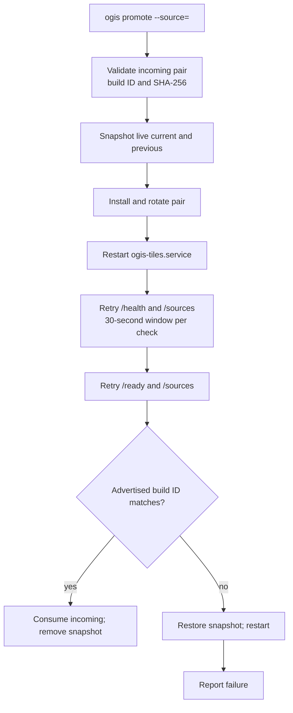

# 6. Operations

Day-to-day operation of the deployed tile server. Phases 5 and 6 are live at
<https://tile.ogis.app>. The server serves planet archives for `pois`, `routes` and `paths` built
from the pinned 2026-10-26 snapshot, plus on-demand `contours`.

Commands below use `ogis` as shorthand for `node bin/ogis.mjs`. Run them from a checkout with a
filled `.env`; the CLI loads `.env` for every command.

## Service shape

| Item          | Value                                                                     |
| ------------- | ------------------------------------------------------------------------- |
| Public origin | `https://tile.ogis.app`                                                   |
| Cloud         | Hetzner CX23, `nbg1`, Ubuntu 26.04                                        |
| Application   | `/opt/ogis-tiles`, user `deploy`                                          |
| Data          | `/opt/ogis-tiles/data`; incoming pairs in `/opt/ogis-tiles/data/incoming` |
| Service       | `ogis-tiles.service`, bound to `127.0.0.1:11010`                          |
| Proxy         | nginx on 80 and 443; certbot TLS                                          |
| Nginx cache   | `/var/cache/nginx/<source>`                                               |
| Service logs  | `journalctl -u ogis-tiles.service`                                        |
| Nginx logs    | `journalctl -u nginx`, `/var/log/nginx/`                                  |

The server is API-only. The development harness is not deployed.

## Status and health

```sh
ogis status
ogis status --cloud-only
ogis status --server-only
ogis status --server <host-or-ip>
```

`ogis status` combines three views:

- the Hetzner Cloud server: name, addresses, type, location, image, status and protection flags;
- the server over SSH: service state, per-source current and previous build IDs, archive presence, and
  loopback `/health` and `/ready` status;
- public `/health` and `/ready` probes over HTTPS.

`--cloud-only` skips the SSH checks and the SSH key. `--server-only` skips the cloud API and
`HCLOUD_TOKEN`. The Sources section is read from the archive directories, not from `GET /sources`.
The full command needs `HCLOUD_TOKEN` for the cloud view and `SSH_PRIVATE_KEY_PATH` for the server
view; the scoped flags drop those requirements.

The three HTTP signals have different jobs:

| Endpoint   | Meaning                                                                                                                     |
| ---------- | --------------------------------------------------------------------------------------------------------------------------- |
| `/health`  | Always returns 200. The body reports `ok` or `degraded` and gives each source's availability and build ID.                  |
| `/ready`   | Returns 200 `{ "status": "ready" }`, or 503 `{ "status": "not_ready", "unavailable": [...] }` while a local source is down. |
| `/sources` | Returns the catalogue for every configured source, including unavailable ones, with availability, build ID and tile URLs.   |

A contour outage does not affect `/ready`; readiness is a local signal. `/health` stays 200 when
degraded, so monitoring must inspect the body or use `/ready`. `ogis promote` and `ogis rollback`
require `/ready` to return 200, which means every configured PMTiles source must be available before
their automated verification can pass.

```sh
curl -s https://tile.ogis.app/health
curl -s -o /dev/null -w '%{http_code}\n' https://tile.ogis.app/ready
curl -s https://tile.ogis.app/sources
```

`ogis status` probes once with a five-second request timeout and does not retry. During a restart,
use the retry guidance in [Service restart and readiness](#service-restart-and-readiness).

## Deploying code and configuration

```sh
ogis deploy --dry-run
ogis deploy
```

`ogis deploy` syncs the server code (`src/`, `bin/`, `config/` and package files), installs
production dependencies with `npm ci --omit=dev`, renders the systemd unit and nginx site, creates
the nginx cache directories, issues or reuses the TLS certificate, restarts the service and reloads
nginx. It preserves `data/` and server-only state, and it never syncs `.env*` files at any depth,
tests, docs, the development harness or build profiles. Keep credentials in the local `.env` or the
environment, not in synced project files. Deploy is not provisioning: it assumes the server, Node.js,
users and directories already exist.

| Flag               | Effect                                                                                         |
| ------------------ | ---------------------------------------------------------------------------------------------- |
| `--dry-run`        | Print the plan; make no local or remote changes.                                               |
| `--skip-certbot`   | Do not request a certificate; reuse an existing one or remain on HTTP.                         |
| `--skip-smoke`     | Skip the post-deploy HTTP and service checks.                                                  |
| `--allow-degraded` | Accept degraded `/sources` and `/ready` responses; `--require-ready` still requires ready 200. |
| `--require-ready`  | Require `/ready` to return 200.                                                                |
| `--server`         | Override the SSH target.                                                                       |

If no certificate exists and `CERTBOT_EMAIL` is empty, deploy fails unless `--skip-certbot` is
used. Certbot needs DNS to resolve to the server and port 80 to be reachable. The deploy smoke checks
`/health`, `/sources`, `/ready` and the service state immediately; it does not use the 30-second
readiness retry that promotion uses. A smoke failure is reported after the unit and nginx changes are
installed and does not roll them back automatically.

Deploy restores the previous systemd unit and nginx site when an install or certbot step fails. If
that restore also fails, the previous files are retained with an `.ogis-backup` suffix and the
server may be inconsistent; see [Investigating a failed deploy](#investigating-a-failed-deploy).

### Rebuilding the server

`ogis provision` rebuilds the existing Hetzner server from cloud-init. It defaults to a dry run;
`--yes` performs the rebuild, and a real rebuild snapshots the server first unless `--no-snapshot`
is used. `--server` selects a server by IP or name and `--host` overrides the hostname.

A rebuild replaces the operating system and local data. It creates the users, keys, directories,
Node.js, nginx, the HTTP-only nginx site and the systemd unit; run `ogis deploy` afterwards to
install TLS and the running configuration. Keep the default snapshot unless you deliberately accept
the data loss.

## Promoting and rolling back

```sh
ogis promote --source=pois --dry-run
ogis promote --source=pois
ogis rollback --source=pois
```

`--source` is required and must name a `pmtiles` source. `--dry-run` prints the remote command and
changes nothing. `--skip-smoke` restarts the service but skips the health, readiness and build-ID
checks; use it only when you will verify the result manually. `--server` overrides the SSH target.

A promotion reads `current.pmtiles` and `build.json` (or `current.json`) from
`data/incoming/<source>/`. It validates that the manifest has a content-addressed build ID, that the
declared archive SHA-256 matches the file, and that the build ID suffix matches the archive hash. It
then snapshots the live pair, installs and rotates it, restarts the service, waits for readiness,
checks the advertised build ID, consumes the incoming pair and removes the snapshot.

A rollback installs the previous pair from `data/<source>/` the same way; it needs no incoming pair.
If there is no previous pair, the rollback fails without changing the current pair.



On failure, the previous pair is restored and the service is restarted. If the restore also fails,
the snapshot is retained at `data/<source>/.deploy-backup-<uuid>/` for manual recovery. The incoming
pair is not consumed on failure, so it can be fixed and retried.

After a multi-source build, promote one source at a time. Promoting several at once widens the
window in which the live set mixes build IDs.

## Remote builds

```sh
ogis build --remote --dry-run --fixture=test/fixtures/alberta-canmore.osm.pbf
ogis build --remote --yes --fixture=test/fixtures/alberta-canmore.osm.pbf
```

Planet runs use a dated snapshot and at least one checksum. The shipped manifest already pins the
2026-10-26 snapshot with both checksums, so the exports below are only needed to override it:

```sh
export PLANET_URL='<dated snapshot URL>'
export PLANET_DATE='<YYYY-MM-DD>'
export PLANET_SHA256='<64 lowercase hex characters>'

ogis build --remote --dry-run
ogis build --remote --yes
```

Omit `PLANET_SHA256` and set `PLANET_MD5` instead when the provider publishes only MD5. Set both to
verify both; SHA-256 is preferred.

A remote build creates a disposable Hetzner Cloud box, syncs the repository, runs the build pipeline
there, and transfers each pair to `data/incoming/<source>/`. It never promotes. The box is billable
from creation until it is destroyed, so `--yes` is required to create it; `--dry-run` prints the
plan and makes no cloud calls.

Remote builds need `HCLOUD_TOKEN`, `TILE_SERVER_HOST`, `SSH_PRIVATE_KEY_PATH` and, unless
`--no-transfer` is set, `BUILD_SSH_PRIVATE_KEY_PATH`. The default box is a `cpx62` in `nbg1` running
`ubuntu-26.04`; override it with `--build-server-type`, `--build-location`, `--build-image` or
`--build-name`, or the matching environment variables.

| Flag                               | Effect                                                                        |
| ---------------------------------- | ----------------------------------------------------------------------------- |
| `--remote`                         | Build on the remote box; required for every other remote flag.                |
| `--yes`                            | Confirm creating the billable box.                                            |
| `--dry-run`                        | Print the plan; no cloud calls.                                               |
| `--keep-build-box`, `--no-destroy` | Keep the box after a successful build. `KEEP_BUILD_BOX=1` does the same.      |
| `--no-transfer`                    | Build without transferring; keeps the box and does not require the build key. |
| `--build-server-type`              | Server type, default `cpx62`.                                                 |
| `--build-location`                 | Location, default `nbg1`.                                                     |
| `--build-image`                    | Image, default `ubuntu-26.04`.                                                |
| `--build-name`                     | Server name, default timestamped.                                             |

The build flags (`--only`, `--fixture`, `--planet-pbf`, planet overrides including
`--planet-sha256` and `--planet-md5`, `--skip-filter`, `--skip-verify`, `--keep-work` and `--force`)
are passed to the build on the box. `--install`, `--allow-unverified-install`, `--skip-download`,
`--skip-build` and `--archive` are rejected for remote builds.

### Planet pins

Without `--fixture`, the preflight requires `PLANET_URL`, `PLANET_DATE` and at least one of
`PLANET_SHA256` or `PLANET_MD5`, including when `--planet-pbf` supplies a local planet PBF. The
shipped `build.planet` block pins the 2026-10-26 snapshot URL and date with both checksums, so a
default planet build needs no overrides. Use a dated snapshot URL; `planet-latest` is rejected.
Values resolve from the flag, then the environment, then `build.planet` in `config/layers.json`.
SHA-256 is preferred, both are verified when both are set, and MD5 must be exactly 32 lowercase
hexadecimal characters. The resolved pins, including `--planet-md5`, are forwarded to the box.

For a fixture build, an adjacent fixture manifest supplies the default SHA-256 when present; an
explicit `--planet-sha256` can override it. Ambient planet pins do not affect fixture checksums, and
MD5 pins apply only to planet inputs.

A build pinned only by MD5 computes the SHA-256 of the PBF for the manifest. The pair transferred to
`data/incoming/<source>/` includes `build.json`, whose `planet.md5` is the verified MD5 pin and whose
`planet.sha256` is the actual SHA-256. Manifests written before MD5 support remain valid because
`planet.md5` is optional. Inspect the manifest before promoting the source.

### Lifecycle

1. **Preflight** — validate the planet pins or fixture, check local inputs, check the tile server
   data filesystem, and probe the restricted build key. Nothing billable exists yet.
2. **Create** — create the labelled box and wait for cloud-init and the pinned toolchain. Cloud-init
   exit status 2 is tolerated because Ubuntu and Hetzner vendor deprecation warnings report
   `extended_status: degraded done`; a hard exit 1 fails. The five tool checks (Node, pmtiles, Java,
   osmium and rsync) are the real gate.
3. **Sync** — rsync the repository to `TILE_APP_DIR` and run `npm ci --include=dev` there.
4. **Build** — run the same pipeline for every selected source.
5. **Transfer** — stage the build key, clear the old incoming pair, and copy each new pair into its
   source directory.
6. **Finish** — remove the build key and destroy the box unless it is kept.

The remote build was first validated end-to-end on a CPX62 with the fixture POI build: preflight,
repository sync, `npm ci`, fixture build, restricted-key transfer to `build@tile.ogis.app:pois/`,
box destruction, then `ogis promote --source=pois`. It has since run end-to-end in planet mode with
the pinned 2026-10-26 snapshot: all three archives were built on a CPX62, transferred to
`data/incoming/`, verified by SHA-256 against their `build.json` and promoted one source at a time.
The box was destroyed after verification; the previous pairs remain installed for rollback.

### Preflight and transfer flags

The preflight prefers a compatible rsync 3.x. It checks `rsync` on `PATH`, then Homebrew
`/opt/homebrew/bin/rsync` and `/usr/local/bin/rsync`. A non-openrsync rsync 3.2.3 or newer writes
the probe with `--mkpath` inside the source's incoming directory. Homebrew rsync is preferred when
installed but is not required.

macOS openrsync 2.6.9 is supported with `--no-dirs`, which suppresses the `--dirs` argument that
openrsync otherwise forwards and `rrsync` 3.4.1 rejects. Without `--mkpath`, the probe writes and
deletes a marker at the `rrsync` root. The delete probe uses `--no-perms`, `--omit-dir-times`,
`--delete`, `--include=/.ogis-preflight-probe` and a literal `--exclude=*` (not shell-quoted). The
build key is write-only inside `/opt/ogis-tiles/data/incoming`, so the probe proves write and delete
permission without reading live data.

Each transfer finds the newest `<outputDir>/<buildId>/<source>/` on the box and requires
`current.pmtiles` and `build.json`. It writes a probe, clears the previous pair and probe with a
delete pass, then copies the new pair with
`--archive --compress --delay-updates --no-group --mkpath` to `build@tile.ogis.app:<source>/`,
relative to the `rrsync` root. `--no-group` preserves the destination's setgid `ogis` group.
`--delay-updates` keeps the new pair out of place until the transfer completes, and the cleared old
pair means a failed transfer leaves nothing for promotion to consume.

`TILE_DATA_DIR` must be `/opt/ogis-tiles/data` and `TILE_INCOMING_DIR` must be
`/opt/ogis-tiles/data/incoming`; the build key is fixed to that path. `TILE_APP_DIR` must be a child
of `/opt` or `/srv` and is the checkout directory on the box.

### Failure handling and cleanup

- A failure before the build starts destroys the box unless it is kept.
- A failure during or after the build keeps the box for inspection and prints the last 200 lines of
  `/opt/ogis-tiles/tmp/remote-build.log`. The full log remains on the box.
- `--keep-build-box`, `--no-destroy` and `KEEP_BUILD_BOX=1` keep a successful box. `--no-transfer`
  also keeps it because the only output would otherwise be destroyed.
- Interrupt cleanup removes local key staging and the remote key, copies the log, destroys the box
  unless it is kept, and removes the per-run `known_hosts` file.
- Name-based cleanup only deletes a server labelled exactly `managed-by=ogis-tiles` and
  `role=build-box`. An unlabelled or foreign same-name server is reported and left untouched.

Once a box exists, the error message includes the server ID. Delete a kept box with the Hetzner CLI
or console:

```sh
hcloud server list -l managed-by=ogis-tiles -l role=build-box
hcloud server delete <id>
```

### Disk and timeouts

A CPX62 has a 640 GB disk: about 10 GiB is required for a fixture build, about 500 GiB for a filtered
planet build, and about 850 GiB for `--skip-filter`, which is rejected on the default disk. Use a
larger server type for an unfiltered build; attaching a volume is not automated.

`BUILD_BOX_TIMEOUT_MS` defaults to 24 hours for the whole build and
`BUILD_BOX_TRANSFER_TIMEOUT_MS` to 4 hours per source. Both should be reviewed for a real planet run.
The tile-server destination preflight requires `BUILD_DESTINATION_MIN_FREE_BYTES` free (8 GiB by
default) and warns at 70% usage. That floor is not a planet capacity plan; see
[Disk capacity](#disk-capacity).

## Service restart and readiness

A manual restart is:

```sh
ssh deploy@tile.ogis.app 'sudo systemctl restart ogis-tiles.service'
```

`systemctl restart` returns when systemd has started the unit, not when Node is listening or has
opened its archives. The unit is `Type=simple` and has no readiness notification, so a request made
immediately after a restart can get a connection error or 503 while the process starts.

Promotion and rollback handle this race. After restarting, they retry `/health` and `/sources` with a
30-second window per check and short request timeouts, then retry `/ready` and `/sources`, and only
then check the advertised build ID. If a window expires, they restore the previous pair and restart
again.

For a manual restart, repeat the readiness check until it succeeds:

```sh
for attempt in $(seq 1 30); do
  curl -fsS https://tile.ogis.app/ready && break
  sleep 1
done
```

Deploy smoke checks do not use this retry loop. If a deploy fails only because the service was still
starting, check `ogis status` and the journal before deciding that the deploy itself failed.

## Disk capacity

Check both the data filesystem and the nginx cache on the server:

```sh
df -h /opt/ogis-tiles/data /var/cache/nginx
du -sh /opt/ogis-tiles/data/* /var/cache/nginx/* 2>/dev/null
```

The CX23 has a 40 GB disk shared by the operating system, the application, `data/` and the nginx
cache. nginx uses a 20 GB cache budget: 2 GB is reserved for contours and the remainder is split
evenly across the PMTiles sources. The cache is bounded by `max_size` and is not preallocated, but it
competes with archives for the same filesystem.

Remote-build preflight checks the tile server data filesystem before creating a box. It aborts below
`BUILD_DESTINATION_MIN_FREE_BYTES` and warns from 70% usage, but it never resizes the server. The
approved capacity path is a manual Hetzner CX33 upgrade in the Hetzner console, taken before the disk
fills. Take a snapshot first; the resize reboots the server and retains the public address. Remote
builds never resize the tile server or the build box.

A planet refresh needs more headroom than a fixture set. Before transferring planet archives, check
the build-box sizes, account for the incoming pair and the current and previous pairs, and raise the
destination floor if necessary. A filtered planet set plus the nginx cache can require the CX33
upgrade. Do not delete `previous.*` while it is the rollback copy; stale incoming pairs from an
abandoned promote can be removed once they are no longer needed.

## TLS, nginx and logs

TLS is issued and renewed by certbot for `tile.ogis.app`. Deploy installs a renewal deploy hook at
`/etc/letsencrypt/renewal-hooks/deploy/ogis-reload-nginx` that reloads nginx after a successful
renewal. Certbot's timer performs the renewal; check it with:

```sh
sudo certbot certificates
sudo certbot renew --dry-run
systemctl list-timers | grep certbot
```

The nginx site is `/etc/nginx/sites-available/tile.ogis.app`, enabled by a symlink in
`sites-enabled`. Deploy owns this file; manual edits are overwritten on the next deploy. Validate and
reload after any manual intervention:

```sh
sudo nginx -t
sudo systemctl reload nginx
```

nginx caches each source under `/var/cache/nginx/<source>` and sets an `X-Cache-Status` header. To
clear a cache, stop nginx, remove the directory contents and start it again; the cache repopulates
on demand. Do this during a quiet period.

Logs are in the systemd journal:

```sh
journalctl -u ogis-tiles.service -f
journalctl -u ogis-tiles.service --since '1 hour ago'
journalctl -u nginx
```

nginx access and error logs are under `/var/log/nginx/`. A 503 from `/ready` is an application
signal, not an nginx error; check the service and source state first.

## Credentials and keys

All credentials live in the local `.env` or the environment. The template is [`.env.example`](../.env.example).
`.env` is gitignored. Both the remote-build sync and the deploy sync exclude `.env*` at any depth, so
a nested file such as `config/.env.local` is never copied to the server. The repository and the
server configuration contain no secrets.

| Variable                     | Purpose                                                                                                  |
| ---------------------------- | -------------------------------------------------------------------------------------------------------- |
| `HCLOUD_TOKEN`               | Hetzner Cloud API token for provisioning, status and remote builds; scoped to the tile-server project.   |
| `SSH_PRIVATE_KEY_PATH`       | Deploy key for provisioning, deployment, status, promote and rollback; its public half is on the server. |
| `BUILD_SSH_PRIVATE_KEY_PATH` | Build-upload key; its public half is restricted on the server and the private half is staged on the box. |
| `CERTBOT_EMAIL`              | Let's Encrypt account email used when deploy issues a certificate.                                       |

Planet checksum pins are build inputs, not credentials; see [Planet pins](#planet-pins) for their
resolution and preflight rules.

The deploy and build keys must be different key material; provisioning refuses identical public
keys. The deploy user has passwordless sudo and a normal login. The build user's key is installed
with a forced command, `rrsync -wo /opt/ogis-tiles/data/incoming`, and the SSH `restrict` option. It
can write and delete inside the incoming root but cannot read live data or run arbitrary commands.

A remote build receives the deploy public key for SSH. The build private key is uploaded only when
the transfer starts, used for that transfer, and removed afterwards; the box is destroyed unless it
is kept. `--no-transfer` does not need the build key.

Key rotation is a provisioning change. Generating new keys and running `ogis provision --yes`
installs the new public keys but rebuilds the server from cloud-init; keep the default snapshot and
expect local data to be replaced. `ogis deploy` does not install SSH keys. Rotating `HCLOUD_TOKEN`
only requires updating `.env`.

## Incident checklist

### `/ready` returns 503

1. Run `ogis status`; check the service state and the per-source current build IDs.
2. Read `curl -s https://tile.ogis.app/health` and `/sources` to identify the unavailable source.
3. Check the journal for archive-open errors, configuration errors or a failed restart.
4. If one source is missing or corrupt, promote a valid incoming pair or roll back to the previous
   pair. A promote cannot pass its `/ready` check while another local source is unavailable; fix all
   unavailable sources first, or use `--skip-smoke` and verify manually.
5. If the service is not running, check disk pressure and
   `sudo systemctl status ogis-tiles.service` before restarting.
6. If only contours are failing, `/ready` should remain 200. Investigate Mapterhorn availability,
   rate limits and `upstream_unavailable` responses instead.

### Investigating a failed promote or rollback

- Read the error: it says whether the previous pair was restored. If the restore succeeded, the
  service was restarted; check `ogis status` and retry once the cause is fixed.
- If the restore failed, the snapshot is at `data/<source>/.deploy-backup-<uuid>/`. Do not delete it.
  Restore the pair manually, restart the service and verify the build ID before removing anything.
- A failed promote leaves the incoming pair in place. Fix the pair or rebuild it; do not promote
  another source until this one is resolved.
- Use `--skip-smoke` only as a last resort and verify `/health`, `/ready`, `/sources` and a sample
  tile manually.

### Investigating a failed deploy

- Deploy restores the previous systemd unit and nginx site when an install or certbot step fails.
  Check `ogis status`, `sudo systemctl status ogis-tiles.service`, `sudo nginx -t` and the journal.
- If the automatic restore failed, previous files are retained as
  `/etc/systemd/system/ogis-tiles.service.ogis-backup` and
  `/etc/nginx/sites-available/tile.ogis.app.ogis-backup`. Restore them manually, then run
  `systemctl daemon-reload`, `nginx -t` and restart or reload.
- If certbot failed, fix DNS or port 80, or deploy with `--skip-certbot` to reuse an existing
  certificate or stay on HTTP until TLS is fixed.
- A smoke failure does not roll back an otherwise installed deploy. Verify whether the service was
  still starting; if it is healthy, no action is needed beyond a re-check.

### Build box left running

- A failed build names the server ID and the `hcloud server delete` command; a kept successful box
  is reported by name and IP. Copy the log and any archives you need before deleting.
- List managed boxes with
  `hcloud server list -l managed-by=ogis-tiles -l role=build-box`; delete the intended box by ID.
- `--keep-build-box`, `--no-destroy` and `--no-transfer` intentionally leave a box running. It stays
  billable until deleted.
- Never delete an unlabelled or foreign server just because its name matches; check the labels.

### Disk pressure

- Check `df -h /opt/ogis-tiles/data /var/cache/nginx` and the largest entries under both paths.
- Remove stale incoming pairs from abandoned promotes, but keep the current and previous pairs.
- Clearing the nginx cache frees space; it repopulates on demand.
- If the data filesystem is approaching capacity, plan the CX33 upgrade before the next planet
  transfer. Take a snapshot, resize in the Hetzner console, then verify with `ogis status` and `df`.
- The remote-build preflight aborts below the free-space floor. Do not lower the floor to force a
  transfer onto a full disk.

### TLS or certificate problems

- Check `sudo certbot certificates` and the certbot timer.
- Confirm DNS resolves to the server and port 80 is reachable for the ACME challenge.
- Re-run `ogis deploy` to reinstall the renewal hook and nginx site. Use `--skip-certbot` only when an
  existing certificate is still valid or a temporary HTTP service is acceptable.

## Related documentation

- [2. Architecture](2.architecture.md) — runtime shape, data layout, deployment topology and HTTP
  contract.
- [5. Build pipelines](5.pipelines.md) — build stages, flags, remote build transfer and verification.
- [7. Roadmap](7.roadmap.md) — Phases 1–6 complete and Phase 7 hardening.
- [Documentation index](README.md)
- [Project README](../README.md)
